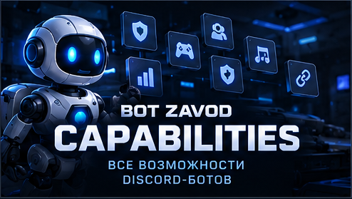

# ⚙️ BOT ZAVOD | Discord Bot Capabilities

**CUSTOM DEVELOPMENT · INTERACTIVE SYSTEMS · AUTOMATION**

### От простой автоматизации до комплексной Discord-системы

*From Simple Automation to Advanced Discord Systems*

[🇷🇺 Русский](#русская-версия) · [🇬🇧 English](#english-version)

[🏠 Главная](README.md) · [🧩 Модули](MODULES.md) · [💎 Услуги](CATALOG.md) · [👑 Разработка](CUSTOM-DEVELOPMENT.md) · [🎮 Портфолио](PORTFOLIO.md) · [📩 Заказ](ORDER.md)

---

## 🇷🇺 Возможности BOT ZAVOD

### Ваши задачи. Индивидуальная реализация.

**BOT ZAVOD** разрабатывает Discord-ботов с интерактивными интерфейсами, автоматизацией и индивидуальной логикой.

Мы создаём как небольшие решения для конкретных задач, так и комплексные системы с несколькими взаимосвязанными модулями.

### Наш подход

- 🎨 Единый визуальный стиль.
- 🖱️ Удобное управление кнопками и меню.
- 🧭 Продуманная навигация.
- ⚙️ Индивидуальная архитектура.
- 🔐 Разделение пользовательских и административных функций.
- 🧩 Взаимодействие модулей.
- 📈 Возможность дальнейшего развития.

**Главное преимущество не количество команд, а удобство использования всей системы.**

---

## 💎 Форматы разработки

| Направление | Для каких задач |
|:---|:---|
| 🚀 **STANDARD DEVELOPMENT** | Небольшие боты и автоматизация отдельных процессов |
| 👑 **PREMIUM DEVELOPMENT** | Комплексные системы, уникальный дизайн и взаимосвязанные функции |
| 🔧 **Доработка существующего проекта** | Добавление функций и улучшение работающего бота |

Это не фиксированные комплекты и не тарифы. Состав функций, стоимость и сроки определяются по техническому заданию.

---

## 🧩 Направления разработки

### 12 категорий возможностей

### 🛡️ 01. Модерация и безопасность

Инструменты поддержания порядка и управления безопасностью Discord-сервера.

**Возможные функции:**

- Автоматическая модерация сообщений.
- Фильтрация спама, ссылок и запрещённых слов.
- Предупреждения и ограничения доступа.
- Управление блокировками.
- Журналы действий.
- Контроль изменений каналов и ролей.
- Защита от массовых разрушительных действий.
- Интерактивные панели модерации.

### 🎫 02. Поддержка и заявки

Системы обработки обращений участников.

**Возможные функции:**

- Создание тикетов через кнопки.
- Категории обращений.
- Приватные каналы поддержки.
- Формы заявок.
- Назначение ответственных.
- Статусы обработки.
- Закрытие и архивирование обращений.
- Уведомления администрации.

### 👥 03. Участники и роли

Автоматизация регистрации и управления доступом.

**Возможные функции:**

- Приветственные сообщения.
- Автоматическая выдача ролей.
- Выбор ролей через кнопки и меню.
- Подтверждение правил.
- Верификация участников.
- Анкеты и регистрационные формы.
- Временные роли.
- Управление доступом к каналам.

### 💰 04. Экономика и магазины

Внутренние виртуальные экономические системы для Discord-сообществ.

**Возможные функции:**

- Виртуальная валюта.
- Персональные балансы.
- Ежедневные награды.
- Магазины ролей и виртуальных предметов.
- Переводы между участниками.
- История операций.
- Инвентарь и достижения.
- Административное управление экономикой.

### 🎮 05. Игровые системы

Механики для игровых сообществ и тематических серверов.

**Возможные функции:**

- Профили игроков.
- Уровни и опыт.
- Мини-игры.
- Кланы и команды.
- Клановая казна.
- Рейтинги.
- Достижения и награды.
- Поиск тиммейтов.
- Турниры и игровые мероприятия.

### 🎵 06. Музыка и голосовые комнаты

Управление музыкальными функциями и голосовыми каналами.

**Возможные функции:**

- Музыкальные панели.
- Управление воспроизведением.
- Очереди композиций.
- Интернет-радио при наличии подходящих источников.
- Автоматические голосовые комнаты.
- Настройка названий и лимитов.
- Управление доступом.
- Информационные панели.

### 🎉 07. Мероприятия и розыгрыши

Автоматизация событий внутри сообщества.

**Возможные функции:**

- Создание мероприятий.
- Регистрация участников.
- Расписание.
- Напоминания.
- Розыгрыши.
- Определение победителей.
- Турнирные заявки.
- Панели организаторов.
- Архив событий.

### 📊 08. Статистика и аналитика

Сбор и представление доступных данных об активности Discord-сервера.

**Возможные функции:**

- Статистика сообщений.
- Голосовая активность.
- Рейтинги участников.
- Рост сообщества.
- Статистика модерации.
- Отчёты поддержки.
- Экономическая аналитика.
- Интерактивные панели.
- Автоматические сводки.

### 🧭 09. Интерактивные интерфейсы

**Одно из ключевых направлений BOT ZAVOD.**

Создание удобного управления ботом без необходимости запоминать множество команд.

**Возможные функции:**

- Главные панели навигации.
- Кнопки и выпадающие меню.
- Формы ввода.
- Персональные панели.
- Административные центры.
- Управление настройками.
- Подсказки и подтверждения действий.
- Единый дизайн всех разделов.

### 🔗 10. Интеграции и автоматизация

Связь Discord с другими сервисами и автоматизация процессов.

**Возможные функции:**

- Интеграции с Telegram.
- Подключение внешних API.
- Вебхуки.
- Уведомления с сайтов.
- Обработка заявок.
- Автоматические публикации.
- Расписания и напоминания.
- Работа с базами данных.
- Синхронизация отдельных данных.

Возможность интеграции зависит от доступности API, разрешений и ограничений сторонних сервисов.

### 💼 11. Управление доступом и подписками

Системы предоставления и контроля доступа к закрытым разделам или мероприятиям.

**Возможные функции:**

- Разовый доступ.
- Подписки на определённый период.
- Автоматическое окончание доступа.
- Выдача ролей.
- Подтверждение заявок администрацией.
- История предоставленных доступов.
- Уведомления о завершении подписки.
- Панели управления услугами.

### 🧠 12. Нестандартные проекты

Разработка индивидуальных систем, которые не ограничиваются типовыми возможностями Discord-ботов.

**Примеры направлений:**

- Уникальные игровые механики.
- Специализированные административные системы.
- Многоэтапные процессы.
- Системы для закрытых сообществ.
- Управление мероприятиями.
- Индивидуальные интеграции.
- Расширение существующих проектов.
- Комплексные Discord-платформы.

**Если нужной функции нет в списке, её можно обсудить отдельно.**

---

## 🎨 Единый дизайн и интерактивное управление

### Интерфейс является частью системы

Мы рассматриваем дизайн не как отдельное украшение, а как важную часть удобства Discord-бота.

В рамках индивидуальной разработки могут использоваться:

- Согласованное оформление панелей.
- Единые принципы навигации.
- Кнопки и меню для основных действий.
- Компактные информационные сообщения.
- Разделение функций по правам доступа.
- Подтверждение важных операций.
- Административные инструменты с понятными настройками.

Визуальная концепция определяется под конкретный проект с учётом технических возможностей Discord.

---

## 🎮 Реальный пример: GAME PLAY

### Авторская игровая Discord-система

**DOTA 2 · CS2 · RUST · PUBG**

**GAME PLAY** демонстрирует подход BOT ZAVOD к объединению нескольких функций в одну интерактивную систему.

В проекте представлены направления:

- Единая навигация.
- Профили участников.
- Виртуальная экономика.
- Мини-игры.
- Кланы.
- Steam-верификация.
- Поддержка.
- Музыкальные и голосовые функции.
- Административные панели.

**Единый дизайн уже реализован и является основой интерфейсов проекта.**

Часть функциональности находится в разработке, интеграции или тестировании. Представленные возможности не следует воспринимать как подтверждение полного производственного запуска.

**GAME PLAY представлен как пример индивидуальной разработки, а не как готовый товар.**

**[🎮 Открыть GAME PLAY](https://github.com/BotZavod/gameplay-discord)**

[📸 Интерфейсы и функции](https://github.com/BotZavod/gameplay-discord/blob/main/docs/FEATURES.md) · [💼 Портфолио](PORTFOLIO.md)

---

## 📩 Обсудить разработку

### От идеи до согласованного проекта

Расскажите, какие задачи должен выполнять Discord-бот.

Мы обсудим функциональность, интерфейсы, техническую реализацию, сроки и стоимость.

**Оплата производится после согласования условий заказа.**

**[🛒 Связаться через FunPay](https://funpay.com/users/14765417/)**

[👑 Индивидуальная разработка](CUSTOM-DEVELOPMENT.md) · [📋 Как заказать](ORDER.md)

---

## 🇬🇧 BOT ZAVOD Capabilities

### Your Requirements. Custom Implementation.

**BOT ZAVOD** develops custom Discord bots featuring interactive interfaces, automation, and tailored functionality.

Our work ranges from focused automation tools to advanced systems with interconnected modules.

### Our Approach

- 🎨 Consistent visual design.
- 🖱️ Interactive buttons and menus.
- 🧭 Intuitive navigation.
- ⚙️ Custom architecture.
- 🔐 Role-based access.
- 🧩 Connected modules.
- 📈 Future expandability.

**Our focus is not the number of commands, but how effectively the entire system works for its users.**

---

## 💎 Development Approaches

| Approach | Suitable For |
|:---|:---|
| 🚀 **STANDARD DEVELOPMENT** | Focused bots and individual automation tasks |
| 👑 **PREMIUM DEVELOPMENT** | Advanced systems with custom interfaces and integrated functionality |
| 🔧 **Existing Bot Development** | Improvements and extensions to existing projects |

These are not fixed packages or pricing tiers. Project scope, pricing, and delivery timelines are agreed upon individually.

---

## 🧩 Development Capabilities

### 12 Areas of Custom Development

### 🛡️ 01. Moderation & Security

Tools for managing Discord community safety and moderation.

**Potential features:**

- Automated message moderation.
- Spam and link filters.
- Warning systems.
- Member restrictions and bans.
- Moderation logs.
- Role and channel change tracking.
- Anti-Nuke protection.
- Interactive moderation panels.

### 🎫 02. Support & Applications

Interactive systems for handling community requests.

**Potential features:**

- Button-based ticket creation.
- Support categories.
- Private support channels.
- Application forms.
- Staff assignment.
- Request statuses.
- Ticket closure and archiving.
- Staff notifications.

### 👥 03. Members, Roles & Verification

Automation for onboarding and access management.

**Potential features:**

- Welcome messages.
- Automatic role assignment.
- Interactive role selection.
- Rules acceptance.
- Member verification.
- Registration forms.
- Temporary roles.
- Channel access management.

### 💰 04. Economy & Virtual Shops

Custom virtual economies for Discord communities.

**Potential features:**

- Virtual currencies.
- Member balances.
- Daily rewards.
- Virtual shops.
- Currency transfers.
- Transaction history.
- Inventories and achievements.
- Economy administration.

### 🎮 05. Gaming Systems

Interactive features for gaming communities.

**Potential features:**

- Player profiles.
- Levels and experience.
- Mini-games.
- Clans and teams.
- Clan treasury.
- Rankings.
- Achievements.
- Teammate discovery.
- Tournaments and events.

### 🎵 06. Music & Voice Systems

Music controls and voice channel management.

**Potential features:**

- Music panels.
- Playback controls.
- Music queues.
- Internet radio with suitable sources.
- Automatic voice rooms.
- Custom room settings.
- Access management.
- Status panels.

### 🎉 07. Events & Giveaways

Community event automation.

**Potential features:**

- Event creation.
- Participant registration.
- Schedules.
- Reminders.
- Giveaways.
- Winner selection.
- Tournament applications.
- Organizer dashboards.
- Event archives.

### 📊 08. Statistics & Analytics

Community activity tracking and reporting.

**Potential features:**

- Message statistics.
- Voice activity tracking.
- Member rankings.
- Community growth reports.
- Moderation analytics.
- Support statistics.
- Virtual economy reports.
- Interactive dashboards.
- Automated summaries.

### 🧭 09. Interactive Interfaces

**One of BOT ZAVOD's core development areas.**

Creating practical bot interfaces without requiring users to memorize numerous commands.

**Potential features:**

- Main navigation panels.
- Buttons and select menus.
- Modal forms.
- Personal dashboards.
- Administration centers.
- Interactive settings.
- Contextual guidance.
- Consistent interface styling.

### 🔗 10. Integrations & Automation

Connecting Discord to external services and automating workflows.

**Potential features:**

- Telegram integrations.
- External APIs.
- Webhooks.
- Website notifications.
- Automated application handling.
- Scheduled publications.
- Reminders.
- Database integrations.
- Selected data synchronization.

Integration feasibility depends on API availability, permissions, and third-party restrictions.

### 💼 11. Membership & Access Management

Systems for controlling access to private content and events.

**Potential features:**

- Single-event access.
- Time-limited subscriptions.
- Access expiration.
- Role assignment.
- Administrative approval.
- Access history.
- Expiration notifications.
- Service management panels.

### 🧠 12. Specialized Projects

Custom solutions beyond standard Discord bot functionality.

**Possible directions:**

- Unique gaming mechanics.
- Specialized administration systems.
- Multi-step workflows.
- Private community systems.
- Event management.
- Custom integrations.
- Existing project extensions.
- Advanced Discord platforms.

**If your required feature is not listed, it can still be discussed individually.**

---

## 🎨 Unified Design & Interactive Management

### Interface Design Is Part of the System

We approach interface design as a core component of usability.

Depending on the project, development may include:

- Consistent panel styling.
- Unified navigation.
- Interactive buttons and menus.
- Compact information messages.
- Permission-based access.
- Confirmation workflows.
- Intuitive administration tools.

Each project's visual identity is developed around its requirements and Discord's supported interface capabilities.

---

## 🎮 Featured Project: GAME PLAY

### Original Discord Gaming System

**DOTA 2 · CS2 · RUST · PUBG**

**GAME PLAY** demonstrates BOT ZAVOD's approach to combining multiple features into a unified interactive Discord system.

The project includes development areas such as:

- Interactive navigation.
- Member profiles.
- Virtual economy.
- Mini-games.
- Clans.
- Steam verification.
- Support systems.
- Music and voice functionality.
- Administration dashboards.

**A consistent visual design has already been implemented throughout the project's interfaces.**

Some functionality remains under development, integration, or testing. The project showcase does not imply that every feature is currently deployed in production.

**GAME PLAY is an example of custom development, not a prebuilt product for sale.**

**[🎮 Explore GAME PLAY](https://github.com/BotZavod/gameplay-discord)**

[📸 Features & Screenshots](https://github.com/BotZavod/gameplay-discord/blob/main/docs/FEATURES.md) · [💼 Portfolio](PORTFOLIO.md)

---

## 📩 Discuss Your Project

### From Your Idea to a Custom Discord Solution

Describe what you need your Discord bot to accomplish.

We can discuss functionality, interface design, technical feasibility, timeline, and pricing.

**Payment is made after the project terms have been agreed upon.**

**[🛒 Contact BOT ZAVOD on FunPay](https://funpay.com/users/14765417/)**

[👑 Custom Development](CUSTOM-DEVELOPMENT.md) · [📋 How to Order](ORDER.md)

---

### ⚙️ Explore BOT ZAVOD

[🏠 Home](README.md) · [🧩 Modules](MODULES.md) · [💎 Services](CATALOG.md) · [👑 Custom Development](CUSTOM-DEVELOPMENT.md) · [🎮 Portfolio](PORTFOLIO.md) · [📩 Order](ORDER.md)

**BOT ZAVOD · Custom Discord Development · Interactive Systems · Automation**

