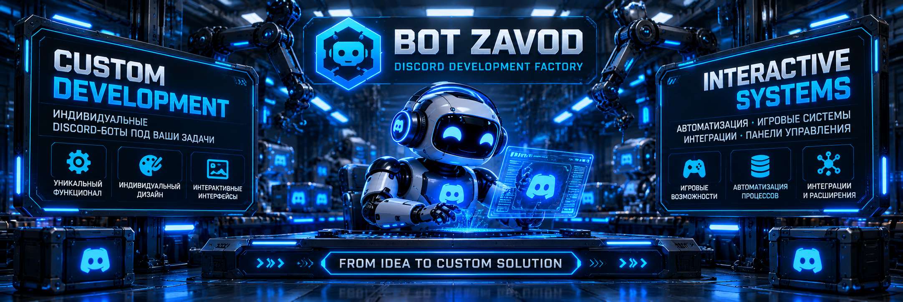

<h1>📦 BOT ZAVOD | Ready-to-Use Discord Bots</h1>

 

**READY-TO-USE DISCORD BOTS · PYTHON · AUTOMATION**

### Готовые решения для Discord-сообществ

*Prebuilt Discord bots for gaming, moderation, support, music, and community management.*

 

[🇷🇺 Русский](#русская-версия) · [🇬🇧 English](#english-version)

 

[🏠 Главная](README.md) · [⚙️ Возможности](CAPABILITIES.md) · [🧩 Модули](MODULES.md) · [💎 Разработка по ТЗ](CUSTOM-DEVELOPMENT.md) · [🎮 Портфолио](PORTFOLIO.md) · [📩 Заказ](ORDER.md)

---

## 🇷🇺 Русская версия

### 🏭 Каталог готовых Discord-ботов

**BOT ZAVOD** предлагает готовые Discord-боты с заранее определённым набором функций.

Это решения для тех, кому не требуется индивидуальная разработка с нуля. Можно выбрать подходящий продукт, получить предусмотренные файлы и настроить бота для своего Discord-сервера.

**Основные направления:**

- 🛡️ Защита и модерация.
- 🎫 Поддержка и обращения.
- 🎮 Игровые возможности.
- 🎵 Музыка и голосовые каналы.
- 👑 Интерактивное управление сервером.
- 🧩 Специализированные инструменты.

> **Важно:** готовый бот не означает автоматически подключённый хостинг. Для запуска необходимы Discord-приложение, токен, подходящая среда выполнения и настройка зависимостей. Состав поставки определяется конкретным предложением.

---

## 🛡️ BASIC

### Защита · Модерация · Логи · Автороль

*Базовая автоматизация Discord-сервера*

**BASIC** — компактный готовый бот для небольших Discord-сообществ, которым нужны основные инструменты безопасности и управления.

### Возможности

- **Anti-Nuke:** защита от массовых разрушительных действий.
- **Модерация:** основные инструменты контроля участников.
- **Логи:** журнал событий Discord-сервера.
- **Автороль:** автоматическая выдача роли новым участникам.
- **Настройка:** основные параметры работы бота.

### Кому подойдёт

- Новым Discord-серверам.
- Небольшим игровым сообществам.
- Проектам, которым нужна базовая автоматизация без сложной системы.

**Формат поставки:** готовый Discord-бот с инструкцией по настройке.

---

## 🎫 COMFORT

### Защита · Модерация · Тикеты · Автороль

*Управление сервером и поддержка участников*

**COMFORT** расширяет возможности BASIC и добавляет систему обращений участников.

### Возможности

- Защита Discord-сервера от массовых разрушительных действий.
- Инструменты модерации.
- Журналирование событий.
- Автоматическая выдача ролей.
- Создание обращений через тикеты.
- Обработка обращений администрацией.
- Закрытие заявок.

### Кому подойдёт

- Сообществам с активной администрацией.
- Серверам, где участникам требуется поддержка.
- Игровым и тематическим проектам.

**Формат поставки:** готовый Discord-бот с системой поддержки.

---

## 🎮 ALL-IN-ONE

### Защита · Поддержка · Мини-игры · Роли

*Универсальный бот для управления и развлечений*

**ALL-IN-ONE** объединяет административные инструменты, поддержку участников и игровые возможности.

### Возможности

- Anti-Nuke и модерация.
- Журнал событий.
- Автоматическая выдача ролей.
- Система тикетов.
- Мини-игры для участников.
- Выдача ролей по реакциям.

### Кому подойдёт

- Игровым сообществам.
- Развлекательным Discord-серверам.
- Проектам, которым нужны несколько функций в одном боте.

**Формат поставки:** готовый многофункциональный Discord-бот.

---

## 🎵 PREMIUM MUSIC

### Музыка · Радио · Автовойсы · Модерация

*Музыкальная и голосовая система Discord-сервера*

**PREMIUM MUSIC** предназначен для Discord-сообществ, которым необходимы музыкальные и голосовые функции.

### Возможности

- Музыкальное воспроизведение.
- Управление музыкальными функциями.
- Интернет-радио.
- Непрерывная работа радио при наличии подходящего хостинга.
- Автоматические голосовые комнаты.
- Инструменты модерации.

### Кому подойдёт

- Музыкальным сообществам.
- Игровым серверам с активными голосовыми каналами.
- Проектам с собственными радиокомнатами.

**Формат поставки:** готовый Discord-бот с музыкальными и голосовыми возможностями.

> Работа отдельных музыкальных источников зависит от их доступности и технических ограничений. Для круглосуточного воспроизведения необходим постоянно работающий хостинг.

---

## 👑 NEXUS PREMIUM

### Интерактивные панели · Админ-центр · Управление ролями

*Комплексная система управления Discord-сообществом*

**NEXUS PREMIUM** — готовое решение с акцентом на интерактивные интерфейсы, удобную навигацию и административные инструменты.

Вместо множества разрозненных команд основные действия организованы через панели и кнопки.

### Возможности

- Интерактивный административный центр.
- Персональные панели участников.
- Управление серверными функциями через кнопки.
- Настройка и изменение ролей.
- Информационные панели.
- Встроенные подсказки.
- Единый согласованный стиль интерфейсов.
- Подтверждение важных действий.

### Особенности интерфейса

- Тёмная визуальная стилистика.
- Компактные панели.
- Удобная навигация.
- Разделение административных и пользовательских действий.
- Понятные элементы управления.

### Кому подойдёт

- Развивающимся Discord-сообществам.
- Серверам с несколькими административными задачами.
- Проектам, которым важны интерактивные интерфейсы.

**Формат поставки:** готовая система управления Discord-сервером.

> Точный перечень административных возможностей определяется комплектацией конкретного предложения.

---

## 🧩 Специализированные готовые боты

### Отдельные решения для конкретных задач

Помимо основных продуктов, BOT ZAVOD предлагает специализированные Discord-боты.

| Продукт | Основное назначение |
|:---|:---|
| 📈 **LEVELING** | Уровни, опыт и активность участников |
| 🎉 **GIVEAWAY** | Организация розыгрышей |
| 📝 **APPLICATION** | Приём и обработка заявок |
| 📅 **EVENTS** | Мероприятия и напоминания |
| 📊 **STATISTICS** | Статистика Discord-сервера |
| ✅ **VERIFY** | Подтверждение участников |
| 🪙 **ECONOMY** | Виртуальная экономика |
| 🛡️ **CLAN** | Клановые функции |

### Преимущества специализированных решений

- Выполняют конкретную задачу.
- Не требуют приобретения большого многофункционального бота.
- Подходят для постепенного развития Discord-сервера.
- Позволяют выбрать только необходимые инструменты.

Комплектация каждого специализированного бота определяется его готовой версией и описанием предложения.

**[🧩 Посмотреть идеи мини-ботов и модулей](MODULES.md)**

---

## 📊 Сравнение основных продуктов

### Выберите подходящий набор возможностей

| Возможность | BASIC | COMFORT | ALL-IN-ONE | PREMIUM MUSIC | NEXUS PREMIUM |
|:---|:---:|:---:|:---:|:---:|:---:|
| Модерация | ✓ | ✓ | ✓ | ✓ | * |
| Anti-Nuke | ✓ | ✓ | ✓ | — | * |
| Журнал событий | ✓ | ✓ | ✓ | — | * |
| Автороль | ✓ | ✓ | ✓ | — | * |
| Тикеты | — | ✓ | ✓ | — | * |
| Мини-игры | — | — | ✓ | — | — |
| Роли по реакциям | — | — | ✓ | — | — |
| Музыка | — | — | — | ✓ | — |
| Радио | — | — | — | ✓ | — |
| Автоматические войсы | — | — | — | ✓ | — |
| Интерактивный админ-центр | — | — | — | — | ✓ |
| Панели участников | — | — | — | — | ✓ |
| Управление ролями через панели | — | — | — | — | ✓ |

**Обозначения:**

- **✓** — функция входит в описанную комплектацию.
- **—** — функция не заявлена для данного продукта.
- **\*** — наличие зависит от конкретной комплектации NEXUS PREMIUM.

> Сравнение основано на заявленных возможностях продуктов. Актуальный состав каждого предложения следует проверять перед приобретением.

---

## 📁 Что получает покупатель

### Файлы · Инструкция · Настройка

В зависимости от выбранного продукта комплект может включать:

- ZIP-архив с файлами Discord-бота.
- Исходный код.
- Инструкцию по установке и запуску.
- Информацию о необходимых зависимостях.
- Описание основных настроек.

### Что необходимо для запуска?

1. Создать собственное Discord-приложение.
2. Получить токен бота.
3. Установить подходящую версию Python и необходимые зависимости.
4. Настроить параметры бота.
5. Запустить его на компьютере или сервере.

Для непрерывной работы необходима постоянно доступная среда выполнения, например VPS.

**Точный состав поставки и требования к запуску определяются описанием выбранного предложения.**

---

## 🔧 Если готового бота недостаточно

### Разработаем решение под конкретную задачу

Не каждому Discord-серверу подходит стандартная комплектация.

В таком случае можно рассмотреть:

- Разработку отдельного мини-бота.
- Добавление функционального модуля.
- Индивидуальную доработку существующего решения.
- Создание нового Discord-бота по техническому заданию.
- Разработку комплексной системы.

**[🧩 Мини-боты и модули](MODULES.md)** · **[⚙️ Все возможности](CAPABILITIES.md)** · **[💎 Индивидуальная разработка](CUSTOM-DEVELOPMENT.md)**

---

## 🛒 Где приобрести готового бота?

### BOT ZAVOD на FunPay

Выберите подходящий продукт и ознакомьтесь с актуальным предложением.

**[🛒 Открыть магазин BOT ZAVOD](https://funpay.com/users/14765417/)**

**[📩 Как оформить заказ](ORDER.md)**

---

## 🇬🇧 English Version

### 📦 Ready-to-Use Discord Bots

*Prebuilt solutions for Discord communities*

**BOT ZAVOD** offers ready-to-use Discord bots with defined feature sets for moderation, support, gaming, music, and community management.

Unlike custom development, these products are based on existing implementations.

Each purchase includes the files and setup materials specified in the selected product listing.

> **Important:** a prebuilt bot still requires configuration, a Discord application, a bot token, dependencies, and a suitable runtime environment. Hosting is not automatically included.

---

## 🛡️ BASIC

### Protection · Moderation · Logs · Autorole

*Essential server management*

**BASIC** is a compact solution for smaller Discord communities.

**Features:**

- Anti-Nuke protection.
- Moderation tools.
- Server event logging.
- Automatic role assignment.
- Basic configuration.

**Best for:**

- New Discord communities.
- Small gaming servers.
- Projects requiring essential automation.

**Delivery format:** ready-to-use Discord bot with setup instructions.

---

## 🎫 COMFORT

### Protection · Moderation · Tickets · Autorole

*Server management and member support*

**COMFORT** expands the BASIC feature set with a support ticket system.

**Features:**

- Anti-Nuke protection.
- Moderation tools.
- Event logging.
- Automatic role assignment.
- Support ticket creation.
- Request management.
- Ticket closure.

**Best for:**

- Communities with active staff.
- Servers requiring member support.
- Gaming and themed communities.

**Delivery format:** ready-to-use Discord bot with support functionality.

---

## 🎮 ALL-IN-ONE

### Protection · Support · Mini-Games · Roles

*Administration and entertainment in one bot*

**ALL-IN-ONE** combines server management, member support, and entertainment features.

**Features:**

- Anti-Nuke protection and moderation.
- Server event logs.
- Automatic roles.
- Support tickets.
- Discord mini-games.
- Reaction roles.

**Best for:**

- Gaming communities.
- Entertainment servers.
- Projects requiring several systems in one bot.

**Delivery format:** ready-to-use multifunctional Discord bot.

---

## 🎵 PREMIUM MUSIC

### Music · Radio · Auto Voice · Moderation

*Music and voice management*

**PREMIUM MUSIC** focuses on music playback and voice channel functionality.

**Features:**

- Music playback.
- Playback management.
- Internet radio.
- Continuous radio operation with suitable hosting.
- Automatic voice rooms.
- Moderation tools.

**Best for:**

- Music communities.
- Gaming servers with active voice channels.
- Discord projects with dedicated radio rooms.

**Delivery format:** ready-to-use Discord bot with music and voice features.

> Music source availability depends on technical and service restrictions. Continuous playback requires suitable always-on hosting.

---

## 👑 NEXUS PREMIUM

### Interactive Panels · Admin Center · Role Management

*Interactive Discord community management*

**NEXUS PREMIUM** is a ready-to-use solution focused on convenient interactive panels, navigation, and administrative tools.

**Features:**

- Interactive administration center.
- Member panels.
- Button-based server management.
- Role configuration and management.
- Information panels.
- Built-in guidance.
- Consistent interface design.
- Confirmation of important actions.

**Interface highlights:**

- Dark visual style.
- Compact navigation.
- Organized user and administrative controls.
- Clear interactive workflows.

**Best for:**

- Growing Discord communities.
- Servers with multiple administrative tasks.
- Projects that prioritize interactive interfaces.

**Delivery format:** ready-to-use Discord management system.

> Exact administrative features depend on the selected product package.

---

## 🧩 Specialized Ready-to-Use Bots

### Focused solutions for individual tasks

| Product | Main Purpose |
|:---|:---|
| 📈 **LEVELING** | Experience, levels, and member activity |
| 🎉 **GIVEAWAY** | Giveaways and winner selection |
| 📝 **APPLICATION** | Application forms and review |
| 📅 **EVENTS** | Events and reminders |
| 📊 **STATISTICS** | Discord server statistics |
| ✅ **VERIFY** | Member verification |
| 🪙 **ECONOMY** | Virtual economy |
| 🛡️ **CLAN** | Clan management features |

**Why choose a specialized bot?**

- Focused functionality.
- No need for a large multifunctional system.
- Suitable for gradual server development.
- Easier to select features for specific requirements.

Each specialized product has its own defined feature set.

**[🧩 Explore Mini Bots & Modules](MODULES.md)**

---

## 📊 Main Product Comparison

### Compare available features

| Feature | BASIC | COMFORT | ALL-IN-ONE | PREMIUM MUSIC | NEXUS PREMIUM |
|:---|:---:|:---:|:---:|:---:|:---:|
| Moderation | ✓ | ✓ | ✓ | ✓ | * |
| Anti-Nuke | ✓ | ✓ | ✓ | — | * |
| Event Logs | ✓ | ✓ | ✓ | — | * |
| Autorole | ✓ | ✓ | ✓ | — | * |
| Tickets | — | ✓ | ✓ | — | * |
| Mini-Games | — | — | ✓ | — | — |
| Reaction Roles | — | — | ✓ | — | — |
| Music | — | — | — | ✓ | — |
| Radio | — | — | — | ✓ | — |
| Auto Voice | — | — | — | ✓ | — |
| Interactive Admin Center | — | — | — | — | ✓ |
| Member Panels | — | — | — | — | ✓ |
| Panel-Based Role Management | — | — | — | — | ✓ |

**Legend:**

- **✓** — included in the described feature set.
- **—** — not listed as an included feature.
- **\*** — availability depends on the specific NEXUS PREMIUM package.

Product features should be verified against the current listing before purchase.

---

## 📁 Delivery & Setup

### Files · Instructions · Configuration

Depending on the selected product, the package may include:

- ZIP archive.
- Bot source files.
- Setup and launch instructions.
- Dependency information.
- Configuration guidance.

### Basic Setup

1. Create a Discord application.
2. Obtain your own bot token.
3. Install a compatible Python environment and dependencies.
4. Configure the bot.
5. Run it on your computer or server.

For continuous operation, an always-available runtime such as a VPS is typically required.

The exact delivery contents are defined in the selected product listing.

---

## 🔧 Need Something Different?

### Custom solutions for specific requirements

If a prebuilt bot does not meet your needs, BOT ZAVOD can discuss:

- Single-purpose mini bots.
- Additional functional modules.
- Modifications to existing solutions.
- Fully custom Discord bots.
- Complete Discord ecosystems.

**[🧩 Mini Bots & Modules](MODULES.md)** · **[⚙️ Development Capabilities](CAPABILITIES.md)** · **[💎 Custom Development](CUSTOM-DEVELOPMENT.md)**

---

## 🛒 Browse Available Products

### BOT ZAVOD on FunPay

Explore available ready-to-use Discord bots and check current product listings.

**[🛒 Visit BOT ZAVOD on FunPay](https://funpay.com/users/14765417/)**

**[📩 How to Order](ORDER.md)**

---

### ⚙️ Explore BOT ZAVOD

[🏠 Home](README.md) · [⚙️ Capabilities](CAPABILITIES.md) · [🧩 Modules](MODULES.md) · [💎 Custom Development](CUSTOM-DEVELOPMENT.md) · [🎮 Portfolio](PORTFOLIO.md) · [📩 Order](ORDER.md)

 

**BOT ZAVOD · Ready-to-Use Discord Bots · Python · Automation**

