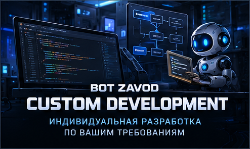

<h1>💎 BOT ZAVOD | Custom Discord Bot Development</h1>

 

**CUSTOM DISCORD BOTS · INTERACTIVE SYSTEMS · AUTOMATION · PYTHON**

### Ваша идея. Индивидуальная архитектура. Собственный Discord-проект.

*Your idea. Custom architecture. Your own Discord solution.*

 

[🇷🇺 Русский](#русская-версия) · [🇬🇧 English](#english-version)

 

[🏠 Главная](README.md) · [⚙️ Возможности](CAPABILITIES.md) · [🧩 Модули](MODULES.md) · [📦 Каталог](CATALOG.md) · [🎮 Портфолио](PORTFOLIO.md) · [📩 Заказ](ORDER.md)

---

## 🇷🇺 Индивидуальная разработка Discord-ботов

### Не просто бот. Решение под ваш проект.

**BOT ZAVOD** занимается разработкой Discord-ботов, интерактивных панелей, систем автоматизации и комплексных решений на Python.

Каждый Discord-сервер имеет собственные задачи. Одному сообществу нужна простая система заявок, другому требуются экономика, роли и игровые механики, а третьему необходима полноценная система с индивидуальными интерфейсами и административным управлением.

**Мы предлагаем разработку под конкретные требования, а не обязательный выбор готового набора функций.**

Вы можете описать идею своими словами, показать примеры понравившихся интерфейсов или предоставить подробное техническое задание.

---

## 🏗️ Масштаб разработки

*От небольшого инструмента до комплексной Discord-экосистемы*

### 01. MINI PROJECT

**Небольшой бот под конкретную задачу**

Подходит для автоматизации одной или нескольких простых операций.

**Примеры:**

- Приветствие участников.
- Автоматическая выдача ролей.
- Подтверждение правил.
- Простая система уведомлений.
- Панель выбора ролей.
- Небольшая система заявок.

**Результат:** компактное решение без лишних функций.

### 02. FUNCTIONAL PROJECT

**Полноценный бот с несколькими модулями**

Подходит для серверов, которым необходим набор связанных возможностей.

**Примеры:**

- Модерация и журналы событий.
- Тикеты и заявки.
- Верификация участников.
- Управление ролями.
- Розыгрыши и мероприятия.
- Уровни и активность.

**Результат:** функциональный бот с согласованной логикой управления.

### 03. ADVANCED PROJECT

**Расширенная Discord-система**

Для проектов с большим количеством функций, пользовательскими данными и интерактивными интерфейсами.

**Примеры:**

- Профили участников.
- Экономика и магазины.
- Игровые механики.
- Кланы и рейтинги.
- Административные панели.
- Система достижений.
- Внутренние сервисы сообщества.

**Результат:** объединённая система, в которой разные модули работают совместно.

### 04. CUSTOM ECOSYSTEM

**Комплексная платформа по индивидуальному ТЗ**

Для нестандартных проектов, которым требуется собственная архитектура.

**Возможные направления:**

- Несколько взаимосвязанных подсистем.
- Индивидуальная структура базы данных.
- Разделение административных прав.
- Интеграции с внешними сервисами.
- Автоматизация сложных процессов.
- Управление доступом.
- Расписания и мероприятия.
- Уникальные интерфейсы.
- Поэтапное расширение проекта.

**Результат:** специализированное решение, разработанное под задачи заказчика.

> Масштаб проекта определяется не количеством команд, а сложностью логики, интерфейсов, интеграций и требованиями к надёжности.

---

## ⚙️ Какие функции можно реализовать?

### Возможности индивидуальной разработки

| Направление | Примеры |
|:---|:---|
| 🛡️ Безопасность | Модерация, Anti-Nuke, фильтры, журналы |
| 👥 Участники | Профили, роли, регистрация, верификация |
| 🎫 Поддержка | Тикеты, заявки, анкеты, обращения |
| 🎮 Игровые системы | Мини-игры, кланы, рейтинги, турниры |
| 🪙 Экономика | Балансы, магазины, предметы, награды |
| 🎵 Голосовые системы | Музыка, радио, временные комнаты |
| 🎉 Мероприятия | Розыгрыши, расписания, регистрация |
| 📊 Аналитика | Статистика, отчёты, информационные панели |
| 🧩 Интерфейсы | Кнопки, меню, формы, административные центры |
| 🔗 Интеграции | Telegram, API, вебхуки, внешние сервисы |
| 💼 Управление доступом | Подписки, роли доступа, сроки действия |
| 🏗️ Автоматизация | Индивидуальные процессы и сценарии |

**[⚙️ Открыть полную библиотеку возможностей](CAPABILITIES.md)**

Если нужной функции нет в списке, её можно обсудить отдельно.

---

## 🎨 Индивидуальный дизайн интерфейсов

### Удобство управления имеет значение

Discord-бот может быть не просто набором команд, а полноценной интерактивной системой с понятной навигацией.

**В зависимости от проекта можно разработать:**

- Главную навигационную панель.
- Пользовательский профиль.
- Панель управления ролями.
- Административный центр.
- Магазин и экономические интерфейсы.
- Панели заявок и поддержки.
- Систему подтверждений.
- Информационные карточки.
- Разделы статистики.
- Единый визуальный стиль.

### Принципы оформления

- **Единая композиция:** взаимосвязанные панели выглядят как части одной системы.
- **Понятная навигация:** пользователь видит доступные действия.
- **Разделение прав:** административные функции доступны только уполномоченным участникам.
- **Подтверждения:** важные операции могут требовать дополнительного подтверждения.
- **Индивидуальность:** интерфейс адаптируется к тематике и задачам сообщества.

Для реализации используются поддерживаемые Discord-инструменты: сообщения, embeds, кнопки, выпадающие меню и модальные формы.

**Дизайн разрабатывается с учётом технических ограничений Discord.**

---

## 🎮 Реальный пример: GAME PLAY

### Комплексная система для игрового сообщества

*Gaming Community · Interactive Systems · Custom Development*

**GAME PLAY** — собственный проект, демонстрирующий подход BOT ZAVOD к созданию многофункциональных Discord-систем.

В нём объединены:

- Интерактивная навигация.
- Профили игроков.
- Виртуальная экономика.
- Игровые механики.
- Кланы.
- Steam-верификация.
- Поддержка участников.
- Административные инструменты.

 

*Пример интерактивной навигации GAME PLAY*

 

**[🎮 Репозиторий GAME PLAY](https://github.com/BotZavod/gameplay-discord)**

**[📸 Все функции и интерфейсы](https://github.com/BotZavod/gameplay-discord/blob/main/docs/FEATURES.md) · [💼 Портфолио BOT ZAVOD](PORTFOLIO.md)**

> GAME PLAY демонстрирует конкретный подход к разработке. Это не универсальный шаблон, который автоматически переносится в каждый заказ.

---

## 🔗 Интеграции и внешние сервисы

### Discord как часть более крупной системы

При необходимости Discord-бот может взаимодействовать с другими сервисами.

**Возможные интеграции:**

- Telegram.
- Внешние API.
- Вебхуки.
- Базы данных.
- Сайты и веб-сервисы.
- Системы уведомлений.
- Внешние панели управления.
- Поддерживаемые игровые сервисы.

**Каждая интеграция оценивается отдельно.** Реализация зависит от наличия доступных интерфейсов, необходимых разрешений и правил сторонних платформ.

---

## 🔄 Развитие существующего проекта

### Не всегда нужно создавать нового бота

В некоторых случаях возможно расширение уже существующего решения.

**Варианты работ:**

- Добавление новой функции.
- Переработка отдельного модуля.
- Создание интерактивной панели.
- Улучшение структуры проекта.
- Подключение базы данных.
- Исправление конкретной проблемы.
- Оптимизация отдельных процессов.
- Подготовка к дальнейшему расширению.

Перед изменением существующего кода необходимо оценить его архитектуру, зависимости и совместимость.

**Требования к сохранению текущих данных и поведения согласовываются до начала работ.**

---

## 🧭 Как проходит разработка?

### От идеи до готового решения

| Этап | Что происходит |
|:---|:---|
| **01. Обсуждение** | Вы описываете задачу, функции и особенности сервера |
| **02. Требования** | Уточняются сценарии, права, интерфейсы и интеграции |
| **03. Оценка** | Определяются техническая возможность, сроки и стоимость |
| **04. Разработка** | Реализуются согласованные функции |
| **05. Проверка** | Тестируются основные сценарии и ограничения доступа |
| **06. Передача** | Предоставляются согласованные файлы и инструкции |
| **07. Развитие** | При необходимости обсуждаются дополнительные работы |

Объём тестирования, состав поставки и условия сопровождения определяются индивидуально.

---

## 📋 Что желательно указать в заявке?

### Необязательно иметь готовое техническое задание

Для предварительного обсуждения полезно сообщить:

1. **Назначение бота.** Игровой сервер, сообщество, поддержка, коммерческий проект или другая задача.
2. **Необходимые функции.** Можно описать своими словами.
3. **Примеры.** Скриншоты, ссылки, похожие интерфейсы.
4. **Пожелания к дизайну.** Панели, кнопки, меню, оформление.
5. **Интеграции.** Telegram, API, сайты или другие сервисы.
6. **Текущее состояние.** Новый проект или доработка существующего бота.
7. **Среда запуска.** Компьютер, VPS или другая инфраструктура.

Если подробного ТЗ нет, структуру требований можно сформировать в процессе обсуждения.

---

## 💬 Стоимость и сроки

### Индивидуальная оценка каждого проекта

На объём работ влияют:

- Количество и сложность функций.
- Необходимость базы данных.
- Уровень интерактивности.
- Внешние интеграции.
- Административные инструменты.
- Требования к тестированию.
- Необходимость доработки существующего проекта.
- Особенности развёртывания и хостинга.

Небольшой бот и комплексная Discord-платформа требуют разного объёма разработки.

**Поэтому для индивидуальных проектов нет единой фиксированной стоимости.** Сроки и условия обсуждаются после уточнения требований.

---

## 📩 Обсудить разработку

### Есть идея для Discord-бота?

**От небольшого инструмента до комплексной системы с уникальными функциями.**

Опишите задачу, а мы обсудим подходящий вариант реализации.

 

**[🛒 Связаться через FunPay](https://funpay.com/users/14765417/)**

**[📋 Как оформить заказ](ORDER.md)**

 

[⚙️ Возможности](CAPABILITIES.md) · [🧩 Модули](MODULES.md) · [📦 Готовые боты](CATALOG.md)

---

## 🇬🇧 Custom Discord Bot Development

### Built Around Your Requirements

**BOT ZAVOD** develops custom Discord bots, interactive interfaces, automation tools, and integrated community systems using Python.

Every community has different needs. Some projects require a small bot for one task, while others need multiple connected modules, persistent data, custom interfaces, and advanced administration.

**Development is tailored to your requirements rather than limited to a predefined package.**

You can describe your idea, share reference examples, or provide a detailed technical specification.

---

## 🏗️ Project Types

*From focused automation to complete Discord ecosystems*

### 01. MINI PROJECT

**A focused bot for a specific task**

Examples:

- Welcome messages.
- Automatic role assignment.
- Rules acceptance.
- Simple notifications.
- Role selection panels.
- Basic application systems.

**Outcome:** a compact solution focused on the required functionality.

### 02. FUNCTIONAL PROJECT

**A multifunctional bot with connected features**

Examples:

- Moderation and logs.
- Ticket systems.
- Member verification.
- Role management.
- Giveaways and events.
- Leveling and activity tracking.

**Outcome:** a functional Discord bot with consistent workflows.

### 03. ADVANCED PROJECT

**An integrated Discord system**

Examples:

- Member profiles.
- Virtual economy and shops.
- Gaming mechanics.
- Clans and leaderboards.
- Administrative dashboards.
- Achievements.
- Community services.

**Outcome:** an integrated solution with modules that work together.

### 04. CUSTOM ECOSYSTEM

**A specialized platform built around individual requirements**

Potential components:

- Multiple connected subsystems.
- Custom database architecture.
- Administrative permission levels.
- External integrations.
- Complex automation.
- Access management.
- Event schedules.
- Custom interfaces.
- Future expansion.

**Outcome:** a tailored system designed around the client's workflows.

> Project complexity depends on architecture, workflows, integrations, and reliability requirements, not simply the number of commands.

---

## ⚙️ Development Capabilities

### Features tailored to your project

| Category | Examples |
|:---|:---|
| 🛡️ Security | Moderation, Anti-Nuke, filters, logs |
| 👥 Members | Profiles, roles, registration, verification |
| 🎫 Support | Tickets, applications, forms |
| 🎮 Gaming | Mini-games, clans, rankings, tournaments |
| 🪙 Economy | Balances, shops, items, rewards |
| 🎵 Voice | Music, radio, temporary voice channels |
| 🎉 Events | Giveaways, schedules, registration |
| 📊 Analytics | Statistics, reports, dashboards |
| 🧩 Interfaces | Buttons, menus, forms, admin centers |
| 🔗 Integrations | Telegram, APIs, webhooks |
| 💼 Membership | Subscriptions, access roles, expiration |
| 🏗️ Automation | Custom workflows and event processing |

**[⚙️ Explore All Capabilities](CAPABILITIES.md)**

Additional ideas can be discussed even if they are not listed.

---

## 🎨 Interactive Interface Design

### A consistent and user-friendly experience

Depending on the project, we can develop:

- Navigation panels.
- Member profiles.
- Role management interfaces.
- Administrative dashboards.
- Economy and shop panels.
- Support interfaces.
- Confirmation workflows.
- Information cards.
- Statistics panels.
- Consistent visual layouts.

### Design Principles

- **Consistency:** connected panels follow a unified design.
- **Navigation:** users can find relevant actions easily.
- **Permissions:** administrative features are restricted appropriately.
- **Confirmations:** important actions can require explicit confirmation.
- **Customization:** interfaces match the community's needs and theme.

Interfaces use supported Discord features, including messages, embeds, buttons, select menus, and modal forms.

All designs are subject to Discord's technical limitations.

---

## 🎮 Featured Project: GAME PLAY

### Interactive Gaming Community System

**GAME PLAY** is an example of a multifunctional Discord project with connected systems and interactive interfaces.

Its documented features include:

- Interactive navigation.
- Player profiles.
- Virtual economy.
- Gaming mechanics.
- Clans.
- Steam verification.
- Member support.
- Administration tools.

 

**[🎮 GAME PLAY Repository](https://github.com/BotZavod/gameplay-discord)**

**[📸 Features & Screenshots](https://github.com/BotZavod/gameplay-discord/blob/main/docs/FEATURES.md) · [💼 BOT ZAVOD Portfolio](PORTFOLIO.md)**

GAME PLAY demonstrates an implementation approach, not a fixed template automatically reused for every client.

---

## 🔗 Integrations & External Services

### Connecting Discord to other systems

Custom projects may integrate with:

- Telegram.
- External APIs.
- Webhooks.
- Databases.
- Websites and web services.
- Notification systems.
- External dashboards.
- Supported gaming services.

Feasibility depends on available interfaces, permissions, access, and third-party service policies.

---

## 🔄 Existing Bot Development

### Extend and improve existing projects

Depending on source code availability and compatibility, we can discuss:

- Adding new features.
- Updating individual modules.
- Creating interactive panels.
- Improving project structure.
- Integrating databases.
- Fixing specific issues.
- Optimizing workflows.
- Preparing a bot for future expansion.

Existing projects require a technical review before changes are agreed upon.

Data preservation and compatibility requirements should be defined before development begins.

---

## 🧭 Development Process

### From concept to delivery

| Stage | Description |
|:---|:---|
| **01. Discussion** | Understand the goals and required functionality |
| **02. Requirements** | Define workflows, permissions, interfaces, and integrations |
| **03. Estimate** | Assess feasibility, scope, timeline, and pricing |
| **04. Development** | Implement the agreed functionality |
| **05. Testing** | Verify relevant workflows and access restrictions |
| **06. Delivery** | Provide the agreed files and setup materials |
| **07. Expansion** | Discuss future improvements if needed |

Testing scope, delivery contents, and support terms are defined individually.

---

## 📋 What to Include in Your Request

### A complete specification is not required

For an initial discussion, it helps to provide:

1. **Purpose:** gaming community, support, business project, or another use case.
2. **Features:** describe the functionality you need.
3. **References:** screenshots, links, or similar interfaces.
4. **Design preferences:** panels, buttons, menus, and visual style.
5. **Integrations:** Telegram, APIs, websites, or other services.
6. **Existing project:** new bot or modification of an existing one.
7. **Hosting:** local computer, VPS, or another environment.

We can help clarify the requirements during the discussion.

---

## 💬 Pricing & Timeline

### Individually estimated projects

Project scope depends on:

- Number and complexity of features.
- Database requirements.
- Interface complexity.
- External integrations.
- Administrative functionality.
- Testing requirements.
- Existing code modifications.
- Deployment and hosting needs.

A small bot and a complete Discord platform require different levels of development effort.

**Custom projects do not have one fixed price.** Pricing and delivery timelines are discussed after the requirements are clarified.

---

## 📩 Discuss Your Project

### Have an idea for a Discord bot?

**From a focused tool to a complex system with custom functionality.**

Describe your requirements and let's discuss a suitable implementation.

 

**[🛒 Contact on FunPay](https://funpay.com/users/14765417/)**

**[📋 How to Order](ORDER.md)**

 

[⚙️ Capabilities](CAPABILITIES.md) · [🧩 Modules](MODULES.md) · [📦 Ready-to-Use Bots](CATALOG.md)

---

### ⚙️ Explore BOT ZAVOD

[🏠 Home](README.md) · [⚙️ Capabilities](CAPABILITIES.md) · [🧩 Modules](MODULES.md) · [📦 Catalog](CATALOG.md) · [🎮 Portfolio](PORTFOLIO.md) · [📩 Order](ORDER.md)

 

**BOT ZAVOD · Custom Discord Development · Interactive Systems · Automation**

