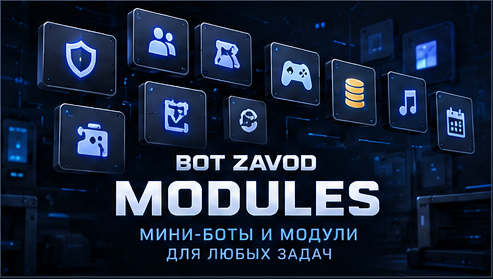

# 🧩 BOT ZAVOD | Custom Discord Bot Modules

**30 НАПРАВЛЕНИЙ РАЗРАБОТКИ**

**CUSTOM MODULES · INTERACTIVE SYSTEMS · AUTOMATION**

*Built Around Your Requirements*

[🇷🇺 Русский](#русская-версия) · [🇬🇧 English](#english-version)

[🏠 Главная](README.md) · [⚙️ Возможности](CAPABILITIES.md) · [💎 Каталог услуг](CATALOG.md) · [👑 Разработка](CUSTOM-DEVELOPMENT.md) · [🎮 Портфолио](PORTFOLIO.md) · [📩 Заказ](ORDER.md)

---

## 🇷🇺 Модули и направления разработки

### 30 направлений для индивидуальных Discord-проектов

**BOT ZAVOD** разрабатывает Discord-ботов под конкретные задачи заказчиков.

Эта страница представляет библиотеку функциональных возможностей, которые можно использовать при составлении технического задания.

**Вы выбираете необходимые функции, а мы обсуждаем их реализацию, оформление и совместную работу.**

Модули могут разрабатываться отдельно или объединяться в комплексную систему с единым интерфейсом.

> Все перечисленные возможности являются примерами направлений разработки, а не готовыми продуктами или фиксированным комплектом. Состав, стоимость и сроки согласовываются индивидуально.

---

## 🛡️ 01. Безопасность и модерация

| № | Модуль | Возможности |
|---|---|---|
| 01 | **Anti-Nuke** | Защита от массовых изменений каналов, ролей и других опасных административных действий |
| 02 | **Moderation** | Предупреждения, ограничения, блокировки и управление нарушениями |
| 03 | **AutoMod** | Автоматическая фильтрация сообщений, ссылок, спама и запрещённого содержимого |
| 04 | **Audit Logs** | Журналы действий участников, модераторов и изменений на сервере |

**Применение:** игровые сообщества, публичные серверы и проекты с активной модерацией.

---

## 👥 02. Участники и роли

| № | Модуль | Возможности |
|---|---|---|
| 05 | **Welcome** | Приветствия новых участников и информационные сообщения |
| 06 | **Auto Roles** | Автоматическое назначение ролей по заданным условиям |
| 07 | **Verification** | Принятие правил, проверка участников и управление доступом |
| 08 | **Role Panels** | Самостоятельный выбор ролей через интерактивные кнопки и меню |

**Применение:** автоматизация входа, распределение участников и управление доступом.

---

## 🎫 03. Поддержка и взаимодействие

| № | Модуль | Возможности |
|---|---|---|
| 09 | **Tickets** | Создание обращений, управление заявками и взаимодействие с поддержкой |
| 10 | **Applications** | Анкеты и формы для набора сотрудников, команд или участников |
| 11 | **Suggestions** | Предложения участников, обсуждение идей и обработка обратной связи |
| 12 | **Reports** | Жалобы, обращения к администрации и регистрация инцидентов |

**Применение:** поддержка пользователей, работа с заявками и автоматизация административных процессов.

---

## 📈 04. Активность и статистика

| № | Модуль | Возможности |
|---|---|---|
| 13 | **Leveling** | Опыт, уровни и награды за активность |
| 14 | **Statistics** | Статистика сообщений, голосовой активности и участников |
| 15 | **Leaderboards** | Рейтинги активности, достижений и других показателей |
| 16 | **Member Profiles** | Профили с персональными данными и результатами участника |

**Применение:** повышение вовлечённости, отслеживание активности и игровые механики сообщества.

---

## 💰 05. Экономика и игровые механики

| № | Модуль | Возможности |
|---|---|---|
| 17 | **Economy** | Виртуальная валюта, баланс, начисления и переводы |
| 18 | **Shop** | Магазин виртуальных товаров, ролей и услуг |
| 19 | **Mini-Games** | Игровые активности и механики с виртуальными наградами |
| 20 | **Inventory** | Хранение виртуальных предметов, наград и приобретений |

**Применение:** игровые сообщества с внутренней экономикой и системой прогрессии.

---

## 🎮 06. Сообщество и мероприятия

| № | Модуль | Возможности |
|---|---|---|
| 21 | **Giveaways** | Проведение розыгрышей с условиями участия |
| 22 | **Events** | Планирование мероприятий, регистрация и уведомления |
| 23 | **Clans** | Создание кланов, управление участниками и клановые функции |
| 24 | **Polls** | Голосования и сбор мнений участников |

**Применение:** игровые команды, мероприятия и развитие сообщества.

---

## 🎵 07. Музыка и голосовые системы

| № | Модуль | Возможности |
|---|---|---|
| 25 | **Music** | Музыкальные функции с интерактивным управлением |
| 26 | **Radio** | Радиопотоки и музыкальные трансляции |
| 27 | **Auto Voice** | Автоматическое создание и управление временными голосовыми комнатами |

**Применение:** игровые серверы, сообщества и голосовые пространства.

---

## ⚙️ 08. Управление и интеграции

| № | Модуль | Возможности |
|---|---|---|
| 28 | **Admin Center** | Централизованная настройка функций через панели и меню |
| 29 | **Notifications** | Автоматические уведомления, напоминания и объявления |
| 30 | **Integrations** | Подключение внешних API, вебхуков и поддерживаемых сервисов |

**Применение:** управление сервером, автоматизация процессов и интеграция с внешними системами.

---

## 🎨 Единый дизайн и интерактивное управление

### Не набор разрозненных команд, а удобная система

В индивидуальных проектах BOT ZAVOD отдельные функции могут объединяться общим интерфейсом.

**Возможности оформления:**

- Интерактивные кнопки и меню.
- Единая навигация между разделами.
- Панели для участников и администрации.
- Информационные карточки.
- Формы ввода данных.
- Подтверждения важных действий.
- Согласованный визуальный стиль.
- Управление доступом на основе ролей и разрешений.

Интерфейсы создаются с учётом возможностей и ограничений Discord.

**[🎨 Подробнее об индивидуальной разработке](CUSTOM-DEVELOPMENT.md)**

---

## 🧩 Примеры сочетания модулей

### Разные задачи. Разные конфигурации.

| Задача | Возможное сочетание |
|:---|:---|
| 🛡️ Безопасность сервера | Anti-Nuke + Moderation + AutoMod + Audit Logs |
| 👥 Управление участниками | Welcome + Auto Roles + Verification + Role Panels |
| 🎫 Центр поддержки | Tickets + Applications + Suggestions + Reports |
| 📊 Система активности | Leveling + Statistics + Leaderboards + Member Profiles |
| 💰 Игровая экономика | Economy + Shop + Mini-Games + Inventory |
| 🏆 Игровое сообщество | Clans + Events + Polls + Leaderboards |
| 🎵 Музыкальный сервер | Music + Radio + Auto Voice |
| ⚙️ Административная система | Admin Center + Notifications + Integrations |

Эти комбинации приведены для примера. Каждый проект может иметь собственный состав функций и уникальную архитектуру.

---

## 🏗️ Развитие проекта по этапам

### Начните с необходимого. Расширяйте по мере развития.

Индивидуальный Discord-бот необязательно должен включать десятки функций с первого дня.

**Этап 1. Основные задачи**

Определяем назначение бота, необходимые роли, права доступа и базовые процессы.

**Этап 2. Интерактивное управление**

Создаём согласованные панели, кнопки, меню и административные инструменты.

**Этап 3. Дополнительные модули**

При необходимости добавляем экономику, статистику, игровые системы, поддержку или другие возможности.

**Этап 4. Расширение и интеграции**

Обсуждаем взаимодействие с внешними сервисами, дополнительные сценарии и дальнейшее развитие.

Каждый этап согласовывается отдельно. Расширение существующего проекта зависит от его архитектуры и совместимости.

---

## 🎮 Пример комплексной разработки: GAME PLAY

**DOTA 2 · CS2 · RUST · PUBG**

**GAME PLAY** — собственный игровой Discord-проект BOT ZAVOD.

В нём объединяются различные направления: интерактивная навигация, профили участников, экономика, мини-игры, кланы, Steam-верификация, музыкальные функции и административное управление.

Особое внимание уделено единому дизайну и удобству работы с панелями.

Часть возможностей реализована, другие продолжают проходить разработку и проверку. GAME PLAY представлен как пример подхода к проектированию, а не как готовый товар.

**[🎮 Репозиторий GAME PLAY](https://github.com/BotZavod/gameplay-discord)**

**[📸 Интерфейсы и функции](https://github.com/BotZavod/gameplay-discord/blob/main/docs/FEATURES.md)**

---

## 📩 Как заказать модули или Discord-бота

**1.** Опишите задачи вашего сервера.

**2.** Выберите интересующие направления или расскажите о собственной идее.

**3.** Обсудим функции, дизайн, совместимость и технические ограничения.

**4.** Согласуем стоимость, сроки и состав работ до оплаты.

**5.** После оформления заказа приступим к реализации утверждённого ТЗ.

**Необязательно выбирать функции только из этой страницы.** Можно обсудить совершенно другую механику или индивидуальную систему.

**[🛒 Обсудить проект на FunPay](https://funpay.com/users/14765417/)**

**[💎 Каталог услуг](CATALOG.md) · [📋 Как заказать](ORDER.md)**

---

## 🇬🇧 Custom Discord Bot Modules

### 30 Development Areas for Custom Projects

**BOT ZAVOD** builds Discord bots tailored to each customer's requirements.

This page presents a library of possible features to help plan a custom project.

**Choose the functionality you need, and we can discuss implementation, design, and integration.**

Modules may be developed individually or combined into a larger Discord system with a unified interface.

> All listed modules represent possible development areas, not ready-to-use products or fixed packages. Scope, pricing, and delivery timelines are agreed upon individually.

---

## 🛡️ 01. Security & Moderation

| # | Module | Features |
|---|---|---|
| 01 | **Anti-Nuke** | Protection against mass changes to channels, roles, and other sensitive server settings |
| 02 | **Moderation** | Warnings, restrictions, bans, and moderation management |
| 03 | **AutoMod** | Automated filtering of messages, links, spam, and prohibited content |
| 04 | **Audit Logs** | Logs of member actions, moderator activity, and server changes |

**Use cases:** gaming communities, public servers, and active moderation teams.

---

## 👥 02. Members & Roles

| # | Module | Features |
|---|---|---|
| 05 | **Welcome** | Welcome messages and onboarding information |
| 06 | **Auto Roles** | Automatic role assignment based on defined conditions |
| 07 | **Verification** | Rules acceptance, member verification, and access management |
| 08 | **Role Panels** | Self-service role selection through buttons and menus |

**Use cases:** member onboarding, role management, and access control.

---

## 🎫 03. Support & Communication

| # | Module | Features |
|---|---|---|
| 09 | **Tickets** | Support requests, ticket management, and staff communication |
| 10 | **Applications** | Forms for staff recruitment, teams, and membership |
| 11 | **Suggestions** | Community suggestions and feedback management |
| 12 | **Reports** | Member reports, complaints, and incident submissions |

**Use cases:** customer support, applications, and administration workflows.

---

## 📈 04. Activity & Statistics

| # | Module | Features |
|---|---|---|
| 13 | **Leveling** | Experience points, levels, and activity rewards |
| 14 | **Statistics** | Message, voice activity, and member statistics |
| 15 | **Leaderboards** | Rankings based on activity, achievements, and other metrics |
| 16 | **Member Profiles** | Profiles displaying member data and achievements |

**Use cases:** engagement, activity tracking, and community progression.

---

## 💰 05. Economy & Gaming

| # | Module | Features |
|---|---|---|
| 17 | **Economy** | Virtual currency, balances, rewards, and transfers |
| 18 | **Shop** | Shops for virtual items, roles, and services |
| 19 | **Mini-Games** | Interactive games and virtual reward systems |
| 20 | **Inventory** | Storage and management of virtual items and rewards |

**Use cases:** gaming communities with internal economies and progression systems.

---

## 🎮 06. Community & Events

| # | Module | Features |
|---|---|---|
| 21 | **Giveaways** | Giveaways with configurable participation requirements |
| 22 | **Events** | Event scheduling, registration, and notifications |
| 23 | **Clans** | Clan creation, membership management, and clan features |
| 24 | **Polls** | Community polls and voting |

**Use cases:** gaming teams, community events, and member engagement.

---

## 🎵 07. Music & Voice Systems

| # | Module | Features |
|---|---|---|
| 25 | **Music** | Music features with interactive controls |
| 26 | **Radio** | Radio streams and music broadcasting |
| 27 | **Auto Voice** | Automatic creation and management of temporary voice channels |

**Use cases:** gaming servers, communities, and voice-focused spaces.

---

## ⚙️ 08. Administration & Integrations

| # | Module | Features |
|---|---|---|
| 28 | **Admin Center** | Centralized configuration through interactive panels |
| 29 | **Notifications** | Automated notifications, reminders, and announcements |
| 30 | **Integrations** | External APIs, webhooks, and supported service integrations |

**Use cases:** server management, workflow automation, and external systems.

---

## 🎨 Unified Design & Interactive Controls

### More Than a Collection of Commands

In custom BOT ZAVOD projects, separate features can be combined into one consistent interface.

**Possible interface elements:**

- Interactive buttons and menus.
- Unified navigation.
- Member and administration panels.
- Information cards.
- Input forms.
- Confirmation workflows.
- Consistent visual styling.
- Role-based access controls.

Interfaces are designed around supported Discord features and platform limitations.

**[🎨 Explore Custom Development](CUSTOM-DEVELOPMENT.md)**

---

## 🧩 Example Module Combinations

### Different Needs. Different Configurations.

| Project Goal | Possible Modules |
|:---|:---|
| 🛡️ Server Security | Anti-Nuke + Moderation + AutoMod + Audit Logs |
| 👥 Member Management | Welcome + Auto Roles + Verification + Role Panels |
| 🎫 Support Center | Tickets + Applications + Suggestions + Reports |
| 📊 Activity System | Leveling + Statistics + Leaderboards + Member Profiles |
| 💰 Gaming Economy | Economy + Shop + Mini-Games + Inventory |
| 🏆 Gaming Community | Clans + Events + Polls + Leaderboards |
| 🎵 Music Community | Music + Radio + Auto Voice |
| ⚙️ Administration System | Admin Center + Notifications + Integrations |

These combinations are examples. Every project can have its own scope and architecture.

---

## 🏗️ Project Development Stages

### Start With Essential Features. Expand When Needed.

A custom Discord bot does not need dozens of features from day one.

**Stage 1. Core Requirements**

Define the bot's purpose, required roles, permissions, and basic workflows.

**Stage 2. Interactive Controls**

Develop the agreed panels, buttons, menus, and administration tools.

**Stage 3. Additional Modules**

Add economy, statistics, gaming systems, support, or other features as required.

**Stage 4. Expansion & Integrations**

Discuss external integrations, advanced workflows, and future development.

Each stage is agreed upon separately. Expanding an existing project depends on its architecture and compatibility.

---

## 🎮 Featured Project: GAME PLAY

**DOTA 2 · CS2 · RUST · PUBG**

**GAME PLAY** is BOT ZAVOD's original gaming Discord project.

It brings together interactive navigation, member profiles, economy features, mini-games, clans, Steam verification, music functionality, and administration tools.

The project emphasizes consistent visual design and practical interactive controls.

Some features are implemented, while others remain under development and validation. GAME PLAY is presented as a development showcase, not a ready-to-use product for sale.

**[🎮 GAME PLAY Repository](https://github.com/BotZavod/gameplay-discord)**

**[📸 Features & Interfaces](https://github.com/BotZavod/gameplay-discord/blob/main/docs/FEATURES.md)**

---

## 📩 Start Your Custom Project

**1.** Describe your server's needs.

**2.** Select relevant development areas or share your own idea.

**3.** Discuss features, design, compatibility, and technical limitations.

**4.** Agree on scope, pricing, and timeline before payment.

**5.** Development begins after the order is confirmed.

**You are not limited to the modules listed here.** Other custom features and systems can be discussed individually.

**[🛒 Contact BOT ZAVOD on FunPay](https://funpay.com/users/14765417/)**

**[💎 Service Catalog](CATALOG.md) · [📋 Ordering Guide](ORDER.md)**

---

### ⚙️ Explore BOT ZAVOD

[🏠 Home](README.md) · [⚙️ Capabilities](CAPABILITIES.md) · [💎 Service Catalog](CATALOG.md) · [👑 Custom Development](CUSTOM-DEVELOPMENT.md) · [🎮 Portfolio](PORTFOLIO.md) · [📩 Order](ORDER.md)

**BOT ZAVOD · Custom Modules · Interactive Systems · Automation**

