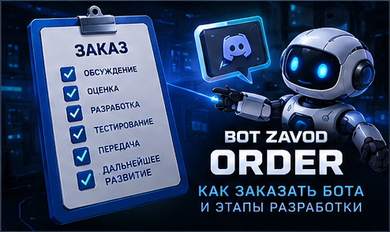

# 📩 BOT ZAVOD | Orders & Development Process

**CUSTOM DEVELOPMENT · INTERACTIVE SYSTEMS · AUTOMATION**

### От вашей идеи до индивидуального Discord-бота

*From Your Idea to a Custom Discord Solution*

[🇷🇺 Русский](#русская-версия) · [🇬🇧 English](#english-version)

[🏠 Главная](README.md) · [⚙️ Возможности](CAPABILITIES.md) · [🧩 Модули](MODULES.md) · [💎 Каталог услуг](CATALOG.md) · [👑 Разработка](CUSTOM-DEVELOPMENT.md) · [🎮 Портфолио](PORTFOLIO.md)

---

## 🇷🇺 Как заказать Discord-бота

### Индивидуальная разработка под ваши задачи

**BOT ZAVOD** разрабатывает Discord-ботов по индивидуальному техническому заданию.

Вы можете заказать небольшую автоматизацию, интерактивные панели или комплексную Discord-систему с собственными механиками и дизайном.

**Каждый заказ обсуждается отдельно.** Функции, стоимость, сроки и состав поставки согласовываются до оплаты.

Готовое техническое задание необязательно. Для начала достаточно описать идею.

---

## 🏗️ 01. Выберите направление разработки

### 🚀 STANDARD DEVELOPMENT

**Discord-бот для конкретных задач**

Подходит для небольших проектов и автоматизации отдельных процессов.

Примеры возможностей:

- Приветствие участников.
- Автоматическая выдача ролей.
- Принятие правил.
- Уведомления и объявления.
- Базовая модерация.
- Журналы действий.
- Тикеты и заявки.
- Кнопки, меню и интерактивные сообщения.

**Основной принцип:** только необходимые функции, согласованные в ТЗ.

**[🚀 Обсудить небольшой проект](https://funpay.com/users/14765417/)**

---

### 👑 PREMIUM DEVELOPMENT

**Индивидуальная Discord-система**

Подходит для игровых сообществ и проектов с расширенной логикой, несколькими взаимосвязанными модулями и индивидуальным интерфейсом.

Примеры возможностей:

- Единый визуальный стиль.
- Интерактивная навигация.
- Административный центр.
- Профили участников.
- Экономика и магазины.
- Игровые механики.
- Кланы и рейтинги.
- Поддержка и заявки.
- Статистика и уведомления.
- Интеграции с внешними сервисами.

**Основной принцип:** индивидуальная архитектура, согласованный функционал и удобное управление.

**[👑 Обсудить комплексный проект](https://funpay.com/users/14765417/)**

> STANDARD и PREMIUM обозначают характер и сложность разработки, а не фиксированные комплекты. Итоговый объём работ определяется техническим заданием.

---

## 🧭 02. Этапы разработки

### Семь шагов от идеи до результата

| Этап | Что происходит |
|:---|:---|
| **01. Обсуждение** | Вы рассказываете о задаче и желаемом результате |
| **02. Требования** | Определяем функции, интерфейсы и особенности проекта |
| **03. Согласование** | Утверждаем ТЗ, стоимость, сроки и состав поставки |
| **04. Оформление заказа** | Покупатель оплачивает согласованный заказ через FunPay |
| **05. Разработка** | Реализуем утверждённый функционал |
| **06. Тестирование** | Проверяем согласованные сценарии работы |
| **07. Передача** | Предоставляем результат и предусмотренные материалы |

### 01 · Обсуждение идеи

Расскажите, для чего нужен бот и какие задачи он должен решать.

Можно описать идею обычными словами, без специальных технических терминов.

**Пример:**

> Нужен Discord-бот для игрового сообщества. Хочу единую панель управления, профили участников, экономику и систему поддержки.

### 02 · Уточнение требований

Обсуждаем:

- Назначение бота.
- Основные функции.
- Сценарии использования.
- Роли и права доступа.
- Интерактивные интерфейсы.
- Хранение данных.
- Необходимые интеграции.
- Требования к запуску.
- Дополнительные ограничения.

### 03 · Согласование проекта

До оплаты определяем:

- Техническое задание.
- Состав функциональности.
- Стоимость.
- Сроки.
- Этапы разработки при необходимости.
- Состав передаваемых материалов.
- Условия исправлений и дополнительных работ.

**Заказ оформляется после согласования существенных условий.**

### 04 · Оформление заказа

После согласования проекта покупатель оплачивает соответствующее предложение через FunPay.

Если оплата произведена без предварительного согласования, необходимо уточнить техническое задание и условия заказа в чате FunPay до начала разработки.

### 05 · Разработка

Создаём согласованные функции, интерфейсы и механики.

Для крупных проектов могут быть предусмотрены промежуточные этапы проверки.

Дополнительные функции, не включённые в утверждённое ТЗ, обсуждаются отдельно.

### 06 · Тестирование

В пределах согласованного объёма проверяются:

- Основные функции.
- Пользовательские сценарии.
- Административные разрешения.
- Работа с данными.
- Взаимодействие модулей.
- Обработка типичных ошибок.

### 07 · Передача проекта

В зависимости от договорённости предоставляются:

- Исходный код.
- Файлы проекта.
- Список зависимостей.
- Инструкция по установке.
- Инструкция по запуску.
- Описание настроек.
- Дополнительные согласованные материалы.

Дальнейшее развитие и сопровождение обсуждаются отдельно.

---

## 📋 03. Что написать при обращении?

### Удобный шаблон технического задания

**Название проекта:**  
Название Discord-сервера или будущего бота.

**Назначение:**  
Для чего нужен бот?

**Необходимые функции:**  
Какие задачи он должен выполнять?

**Интерфейс:**  
Нужны ли кнопки, меню, формы, панели и индивидуальный дизайн?

**Участники и администрация:**  
Кто будет пользоваться ботом и какие действия должны быть доступны разным ролям?

**Интеграции:**  
Нужны ли Telegram, сайт, API или другие сервисы?

**Существующий проект:**  
Создаём нового бота или дорабатываем существующего?

**Запуск:**  
Windows, Linux VPS или другая среда?

**Примеры:**  
Скриншоты, ссылки или описания понравившихся решений.

**Дополнительные пожелания:**  
Всё, что важно учесть.

> Необязательно заполнять каждый пункт. Недостающие детали можно уточнить во время обсуждения.

---

## 🎨 04. Дизайн и интерфейсы

### Удобство взаимодействия с ботом

По согласованию проект может включать:

- Интерактивные кнопки.
- Выпадающие меню.
- Формы ввода данных.
- Панели навигации.
- Пользовательские профили.
- Административные центры.
- Информационные сообщения.
- Подтверждения важных действий.
- Единый визуальный стиль.

Оформление создаётся с учётом поддерживаемых возможностей Discord.

**Пример индивидуальной разработки: [🎮 GAME PLAY](https://github.com/BotZavod/gameplay-discord)**

---

## 🖥️ 05. Запуск и хостинг

### Где будет работать Discord-бот?

| Среда | Особенности |
|:---|:---|
| 💻 Windows | Бот работает при запущенной программе и доступном соединении |
| ☁️ Linux VPS | Подходит для длительной и круглосуточной работы |
| ⚙️ Другая инфраструктура | Возможность использования определяется совместимостью |

**Хостинг, аренда VPS, установка и дальнейшее обслуживание не включаются автоматически.** Эти услуги согласовываются отдельно.

Для безопасности токен Discord-бота и другие секреты не следует публиковать в открытых репозиториях или сообщениях.

---

## 🔧 06. Доработка существующего бота

### Развитие проекта без полной переработки

Если у вас уже есть Discord-бот, можно обсудить:

- Добавление новых функций.
- Создание интерактивных панелей.
- Изменение существующих механик.
- Исправление конкретных ошибок.
- Подключение базы данных.
- Интеграции с внешними сервисами.
- Улучшение структуры проекта.
- Подготовку к дальнейшему развитию.

Перед согласованием работ необходимо оценить исходный код, зависимости, архитектуру и совместимость.

**Возможность сохранения существующих данных и функций определяется после технической проверки.**

---

## 💬 07. Частые вопросы

### FAQ

**Обязательно ли иметь готовое ТЗ?**

Нет. Можно начать с описания идеи и сформировать требования во время обсуждения.

**Можно ли заказать только одну функцию?**

Да. Небольшие задачи также рассматриваются как индивидуальная разработка.

**Можно ли объединить несколько модулей в одного бота?**

Да, если это технически осуществимо. Архитектура и взаимодействие модулей обсуждаются заранее.

**Можно ли заказать уникальный дизайн?**

Да, в пределах возможностей интерфейсов Discord.

**Можно ли подключить Telegram или другой сервис?**

Возможность интеграции зависит от доступных API, разрешений и правил соответствующих платформ.

**Можно ли доработать существующего бота?**

Да, после оценки его исходного кода и технического состояния.

**Будет ли бот работать круглосуточно?**

Для работы 24/7 обычно требуется постоянно доступный компьютер или сервер. Хостинг согласовывается отдельно.

**Сколько стоит разработка?**

Стоимость определяется индивидуально по согласованному техническому заданию.

**Когда нужно оплачивать заказ?**

После согласования функциональности, стоимости, сроков и других существенных условий.

**Можно ли изменить ТЗ после начала работы?**

Изменения обсуждаются отдельно и могут повлиять на стоимость и сроки.

**Какая поддержка предоставляется после передачи?**

Условия исправления ошибок, поддержки и дальнейшего сопровождения определяются при согласовании заказа.

---

## 📩 Заказать индивидуального Discord-бота

### BOT ZAVOD | Custom Discord Development

**STANDARD DEVELOPMENT · PREMIUM DEVELOPMENT**

От небольшой автоматизации до сложной системы с интерактивными интерфейсами.

**Сначала обсуждаем задачу, затем согласовываем условия и оформляем заказ.**

**[🛒 Связаться через FunPay](https://funpay.com/users/14765417/)**

[💎 Каталог услуг](CATALOG.md) · [🧩 Модули](MODULES.md) · [👑 Индивидуальная разработка](CUSTOM-DEVELOPMENT.md) · [🎮 Портфолио](PORTFOLIO.md)

---

## 🇬🇧 How to Order a Discord Bot

### Custom Development Built Around Your Requirements

**BOT ZAVOD** develops Discord bots tailored to individual project requirements.

Whether you need a small automation tool, interactive interfaces, or an advanced Discord system, the functionality and project scope are discussed individually.

**Pricing, delivery timelines, and deliverables are agreed upon before payment.**

A complete technical specification is not required for the initial discussion.

---

## 🏗️ 01. Choose Your Development Approach

### 🚀 STANDARD DEVELOPMENT

**Discord Bots for Specific Tasks**

Suitable for smaller projects and focused automation.

Possible features include:

- Welcome messages.
- Automatic role assignment.
- Rules acceptance.
- Notifications and announcements.
- Basic moderation.
- Activity logs.
- Support tickets and applications.
- Interactive buttons and menus.

**Focus:** practical functionality tailored to your requirements.

**[🚀 Discuss a Standard Project](https://funpay.com/users/14765417/)**

---

### 👑 PREMIUM DEVELOPMENT

**Advanced Custom Discord Systems**

Suitable for gaming communities and projects requiring integrated functionality and custom interfaces.

Possible features include:

- Consistent visual design.
- Interactive navigation.
- Administration dashboards.
- Member profiles.
- Virtual economy and shops.
- Gaming mechanics.
- Clans and rankings.
- Support systems.
- Statistics and notifications.
- External integrations.

**Focus:** custom architecture, connected modules, and intuitive management.

**[👑 Discuss an Advanced Project](https://funpay.com/users/14765417/)**

> STANDARD and PREMIUM describe typical project complexity, not fixed feature packages. The final scope is determined by the agreed requirements.

---

## 🧭 02. Development Process

### Seven Steps From Idea to Delivery

| Stage | Description |
|:---|:---|
| **01. Discussion** | Explain your goals and expected outcome |
| **02. Requirements** | Define features, interfaces, and technical needs |
| **03. Agreement** | Confirm scope, price, timeline, and deliverables |
| **04. Order** | Complete payment through FunPay under the agreed terms |
| **05. Development** | Implement the approved functionality |
| **06. Testing** | Verify the agreed workflows |
| **07. Delivery** | Receive the completed project and agreed materials |

### Step 1 · Initial Discussion

Describe what your bot should do and which problems it should solve.

You can start with a simple explanation. Technical terminology is not required.

### Step 2 · Requirements

We clarify:

- Project purpose.
- Required features.
- User workflows.
- Roles and permissions.
- Interface design.
- Data storage.
- External integrations.
- Hosting requirements.
- Technical limitations.

### Step 3 · Project Agreement

Before payment, we confirm:

- Technical requirements.
- Functional scope.
- Project price.
- Delivery timeline.
- Milestones, if applicable.
- Deliverables.
- Support and modification terms.

**Development begins after the essential order terms have been agreed upon and the order has been placed.**

### Step 4 · Placing the Order

The customer completes payment through FunPay according to the agreed project terms.

If payment is made without prior consultation, the requirements and order terms must be clarified in FunPay chat before development begins.

### Step 5 · Development

The approved features and interfaces are implemented.

Larger projects may be divided into milestones.

Features outside the agreed scope are discussed separately.

### Step 6 · Testing

Testing may cover:

- Core functionality.
- User workflows.
- Administration permissions.
- Data handling.
- Module interactions.
- Common error scenarios.

Testing is performed within the agreed project scope.

### Step 7 · Delivery

Depending on the agreement, deliverables may include:

- Bot source code.
- Project files.
- Dependency information.
- Setup instructions.
- Launch instructions.
- Configuration guidance.
- Additional agreed documentation.

Further development and maintenance can be discussed separately.

---

## 📋 03. Project Request Template

### What Should You Include?

**Project name:**  
Your Discord server or future bot name.

**Purpose:**  
What should the bot accomplish?

**Required features:**  
Which tasks should it perform?

**Interface:**  
Do you need buttons, menus, forms, dashboards, or custom styling?

**Members and administration:**  
Who will use the bot, and which permissions are required?

**Integrations:**  
Telegram, websites, APIs, or other services.

**Existing project:**  
Is this a new bot or an extension of an existing one?

**Hosting:**  
Windows, Linux VPS, or another environment.

**References:**  
Screenshots, links, or examples of similar systems.

**Additional notes:**  
Anything else that should be considered.

> You do not need to complete every field. Missing details can be clarified during the discussion.

---

## 🎨 04. Interface Design

### Practical and Consistent Discord Interfaces

Custom projects may include:

- Interactive buttons.
- Select menus.
- Modal forms.
- Navigation panels.
- Member profiles.
- Administration dashboards.
- Information messages.
- Confirmation workflows.
- Consistent visual styling.

All interfaces are designed around Discord's supported features and technical limitations.

**Featured project: [🎮 GAME PLAY](https://github.com/BotZavod/gameplay-discord)**

---

## 🖥️ 05. Hosting & Deployment

### Where Will Your Bot Run?

| Environment | Notes |
|:---|:---|
| 💻 Windows | Runs while the application and connection remain available |
| ☁️ Linux VPS | Suitable for long-running and continuous operation |
| ⚙️ Other infrastructure | Evaluated based on compatibility and project requirements |

**Hosting, VPS rental, deployment, and ongoing maintenance are not automatically included.**

Never publish Discord bot tokens or other credentials in public repositories or messages.

---

## 🔧 06. Existing Bot Modifications

### Improve or Expand Your Current Project

Possible services include:

- Adding new functionality.
- Creating interactive panels.
- Modifying existing mechanics.
- Fixing specific issues.
- Database integration.
- External service integrations.
- Improving project structure.
- Preparing for future expansion.

A technical review of the available source code, dependencies, and architecture is required before confirming feasibility.

**Data preservation and compatibility requirements must be evaluated before development.**

---

## 💬 07. Frequently Asked Questions

### FAQ

**Do I need a complete technical specification?**

No. You can start with your idea and clarify the requirements during consultation.

**Can I order just one feature?**

Yes. Small, focused tasks can be handled as custom development.

**Can several modules be combined into one bot?**

Yes, subject to technical feasibility and compatibility.

**Can I request a unique design?**

Yes, within Discord's supported interface capabilities.

**Can you integrate Telegram or other services?**

Integrations depend on available APIs, permissions, and third-party platform policies.

**Can you modify an existing bot?**

Yes, after reviewing its source code and technical condition.

**Will the bot run 24/7?**

Continuous operation usually requires suitable always-available hosting, which is discussed separately.

**How much does development cost?**

Pricing depends on the agreed scope and complexity.

**When should I pay?**

After the functionality, price, timeline, and other essential project terms have been agreed upon.

**Can I change the requirements after development begins?**

Changes can be discussed separately and may affect pricing and delivery timelines.

**What support is provided after delivery?**

Bug-fix, support, and maintenance terms are agreed upon for each order.

---

## 📩 Start Your Custom Discord Project

### BOT ZAVOD | Custom Discord Development

**STANDARD DEVELOPMENT · PREMIUM DEVELOPMENT**

From focused automation to advanced Discord systems with interactive interfaces.

**Discuss your requirements, confirm the terms, and place your order.**

**[🛒 Contact BOT ZAVOD on FunPay](https://funpay.com/users/14765417/)**

[💎 Service Catalog](CATALOG.md) · [🧩 Modules](MODULES.md) · [👑 Custom Development](CUSTOM-DEVELOPMENT.md) · [🎮 Portfolio](PORTFOLIO.md)

---

### ⚙️ Explore BOT ZAVOD

[🏠 Home](README.md) · [⚙️ Capabilities](CAPABILITIES.md) · [🧩 Modules](MODULES.md) · [💎 Service Catalog](CATALOG.md) · [👑 Custom Development](CUSTOM-DEVELOPMENT.md) · [🎮 Portfolio](PORTFOLIO.md)

**BOT ZAVOD · Custom Discord Bots · Interactive Systems · Automation**

