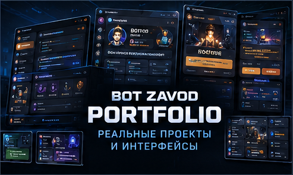

<h1>🎮 BOT ZAVOD | Portfolio & Projects</h1>

 

**REAL PROJECTS · DISCORD INTERFACES · PYTHON DEVELOPMENT**

### От идеи до полноценной Discord-системы

*From an idea to a complete Discord system.*

 

[🇷🇺 Русский](#русская-версия) · [🇬🇧 English](#english-version)

 

[🏠 Главная](README.md) · [⚙️ Возможности](CAPABILITIES.md) · [🧩 Модули](MODULES.md) · [📦 Каталог](CATALOG.md) · [💎 Разработка по ТЗ](CUSTOM-DEVELOPMENT.md) · [📩 Заказ](ORDER.md)

---

## 🇷🇺 Портфолио BOT ZAVOD

### Разработка, которую можно увидеть

**BOT ZAVOD** разрабатывает Discord-ботов, интерактивные интерфейсы, игровые системы и инструменты автоматизации на Python.

Здесь представлены собственные проекты и готовые продукты, демонстрирующие наш подход к разработке.

Мы разделяем три направления:

| Направление | Описание |
|:---|:---|
| 🎮 **Собственные проекты** | Индивидуальные системы и практические разработки |
| 📦 **Готовые продукты** | Discord-боты с заранее определённой функциональностью |
| 💎 **Разработка на заказ** | Новые решения по требованиям заказчика |

> Не все готовые продукты являются клиентскими кейсами. Некоторые представлены как самостоятельные разработки BOT ZAVOD.

---

## 🎮 GAME PLAY

### Gaming Community Ecosystem

**DOTA 2 · COUNTER-STRIKE 2 · RUST · PUBG**

**GAME PLAY** — собственный игровой Discord-проект с комплексной системой управления сообществом.

Вместо множества независимых инструментов в нём используется объединённая система: интерактивная навигация, профили игроков, внутренняя экономика, игровые механики, кланы и административные функции.

Проект демонстрирует не только отдельные возможности Discord-бота, но и их взаимодействие внутри единой архитектуры.

**[🎮 Репозиторий GAME PLAY](https://github.com/BotZavod/gameplay-discord)**

**[📸 Подробный обзор функций](https://github.com/BotZavod/gameplay-discord/blob/main/docs/FEATURES.md) · [💬 Discord-сервер](https://discord.gg/5ENDb7e4vj)**

---

## 01 · Интерактивная навигация

### Единая система управления

Центральные панели позволяют участникам пользоваться возможностями Discord-сервера без необходимости запоминать большое количество команд.

**Особенности:**

- Разделение функций по тематическим панелям.
- Интерактивные кнопки и элементы управления.
- Переходы между разделами.
- Согласованный визуальный стиль.
- Контроль доступа к отдельным действиям.

---

## 02 · Профиль участника

### Игровая информация в одном месте

Система профилей объединяет информацию об участнике и его активности внутри игрового сообщества.

**Возможности:**

- Персональный профиль.
- Виртуальный баланс.
- Уровень и опыт.
- Информация о клане.
- Steam-статус.
- Дополнительные игровые показатели.

---

## 03 · Экономика и магазин

### Виртуальная экономика сообщества

Внутренняя экономика объединяет игровые активности, виртуальную валюту, награды и магазин.

**Возможности:**

- Виртуальный баланс участников.
- Внутренний магазин.
- Покупка доступных наград.
- История операций.
- Ежедневные бонусы.
- Связь экономики с игровыми механиками.

---

## 04 · Игровые механики

### Дополнительная активность участников

Игровой раздел расширяет взаимодействие участников за пределы обычного общения.

**Возможности:**

- Выбор мини-игр.
- Виртуальные игровые награды.
- Ограничения игровых операций.
- Связь с внутренней экономикой.
- Дополнительные игровые механики.

---

## 05 · Steam-верификация

### Подтверждение игрового профиля

Отдельная система помогает участнику пройти предусмотренную проектом процедуру Steam-подтверждения.

**Особенности:**

- Специализированная панель.
- Понятный сценарий для участника.
- Отображение статуса подтверждения.
- Связь с пользовательским профилем.

---

## 06 · Поддержка участников

### Интерактивная система обращений

Система поддержки встроена в общую структуру Discord-сервера.

**Возможности:**

- Создание обращений через интерактивную панель.
- Разделение запросов.
- Управление доступом.
- Обработка тикетов администрацией.
- Защита от повторного создания обращений.

---

## 🧩 Архитектурный подход

### Несколько подсистем. Один проект.

GAME PLAY демонстрирует, как разные функциональные направления могут быть объединены в одной системе.

| Направление | Реализация |
|:---|:---|
| 🧭 **Навигация** | Панели, кнопки и переходы |
| 👥 **Участники** | Профили, уровни, роли |
| 🪙 **Экономика** | Баланс, магазин, награды |
| 🎮 **Развлечения** | Мини-игры |
| 🛡️ **Сообщества** | Кланы |
| 🔗 **Верификация** | Steam-подтверждение |
| 🎫 **Поддержка** | Тикеты и обращения |
| ⚙️ **Администрирование** | Управление серверными функциями |

**GAME PLAY не является универсальным шаблоном для всех заказов.** Каждый новый проект проектируется с учётом собственных требований, структуры и задач.

---

## 📦 Готовые разработки BOT ZAVOD

### От базовой защиты до интерактивных систем

Помимо GAME PLAY, в линейке BOT ZAVOD представлены готовые Discord-боты.

| Продукт | Основное назначение |
|:---|:---|
| 🛡️ **BASIC** | Защита, модерация, логи и автороль |
| 🎫 **COMFORT** | Управление сервером и тикеты |
| 🎮 **ALL-IN-ONE** | Модерация, поддержка и мини-игры |
| 🎵 **PREMIUM MUSIC** | Музыка, радио и голосовые комнаты |
| 👑 **NEXUS PREMIUM** | Интерактивное управление сообществом |

### Специализированные продукты

**LEVELING · GIVEAWAY · APPLICATION · EVENTS · STATISTICS · VERIFY · ECONOMY · CLAN**

Это отдельные решения для конкретных задач Discord-сообществ.

**[📦 Посмотреть полный каталог готовых ботов](CATALOG.md)**

---

## 🎨 Наш подход к интерфейсам

### Функциональность должна быть удобной

Для BOT ZAVOD важна не только реализация функций, но и то, как участники взаимодействуют с ботом.

**Принципы разработки:**

- Понятная навигация.
- Минимум лишних действий.
- Логичная структура разделов.
- Интерактивные кнопки и меню.
- Подтверждение важных операций.
- Разделение пользовательских и административных прав.
- Согласованное оформление.
- Возможность дальнейшего расширения.

Визуальные решения подбираются под конкретный проект, а не копируются автоматически из GAME PLAY.

---

## 💎 Индивидуальные проекты

### Разработка под конкретные требования

Нужен Discord-бот с собственными механиками, дизайном или интеграциями?

Можно обсудить:

- Небольшой бот для одной задачи.
- Функциональную систему из нескольких модулей.
- Комплексную платформу для сообщества.
- Уникальные интерактивные панели.
- Интеграции с внешними сервисами.
- Развитие существующего проекта после технической оценки.

**[💎 Подробнее об индивидуальной разработке](CUSTOM-DEVELOPMENT.md)**

---

## 📩 Обсудить проект

### Ваш Discord-проект может стать следующим

Опишите идею, задачи и желаемые возможности. Мы обсудим техническую реализацию, сроки и стоимость.

**[🛒 Связаться через FunPay](https://funpay.com/users/14765417/)**

**[📋 Как оформить заказ](ORDER.md)**

---

## 🇬🇧 English Version

### Real Projects & Discord Development

**BOT ZAVOD** develops Discord bots, interactive interfaces, gaming systems, and community automation using Python.

This portfolio showcases our own projects and ready-to-use products.

We distinguish between:

- **Original projects:** independently developed systems demonstrating our approach.
- **Prebuilt products:** Discord bots with defined functionality.
- **Custom development:** individually commissioned solutions built around client requirements.

Not every prebuilt product is a client case study.

---

## 🎮 GAME PLAY

### Gaming Community Ecosystem

**DOTA 2 · COUNTER-STRIKE 2 · RUST · PUBG**

**GAME PLAY** is a custom Discord gaming community project built around connected systems and interactive interfaces.

Instead of relying on multiple unrelated bots, the project brings navigation, player profiles, virtual economy, gaming mechanics, clans, and administration into a unified experience.

**[🎮 Project Repository](https://github.com/BotZavod/gameplay-discord)**

**[📸 Full Feature Showcase](https://github.com/BotZavod/gameplay-discord/blob/main/docs/FEATURES.md) · [💬 Discord Community](https://discord.gg/5ENDb7e4vj)**

---

## 01 · Interactive Navigation

### Centralized community controls

Interactive navigation panels help members access server features without memorizing large numbers of commands.

**Highlights:**

- Themed navigation panels.
- Interactive buttons and controls.
- Convenient section navigation.
- Consistent visual styling.
- Permission-aware actions.

---

## 02 · Player Profiles

### Member information in one place

The profile system brings together player information and community activity.

**Features:**

- Personal profiles.
- Virtual balances.
- Levels and experience.
- Clan information.
- Steam status.
- Additional gaming statistics.

---

## 03 · Economy & Shop

### Integrated virtual economy

The virtual economy connects gaming activities, virtual currency, rewards, and shop functionality.

**Features:**

- Virtual member balances.
- Virtual shop.
- Purchasable rewards.
- Transaction history.
- Daily bonuses.
- Integration with gaming mechanics.

---

## 04 · Gaming Mechanics

### Interactive community activities

Gaming features encourage interaction beyond regular text and voice communication.

**Features:**

- Mini-game selection.
- Virtual gaming rewards.
- Gameplay limits.
- Integration with the internal economy.
- Additional gaming mechanics.

---

## 05 · Steam Verification

### Player account verification workflow

A dedicated interface guides members through the project's Steam verification workflow.

**Highlights:**

- Dedicated verification panel.
- Clear user workflow.
- Verification status display.
- Integration with player profiles.

---

## 06 · Member Support

### Interactive support system

The support system is integrated into the Discord community structure.

**Features:**

- Interactive ticket creation.
- Request categories.
- Access controls.
- Staff ticket management.
- Duplicate request prevention.

---

## 🧩 Architecture & Integration

### Multiple systems. One project.

| System | Description |
|:---|:---|
| 🧭 **Navigation** | Interactive panels and buttons |
| 👥 **Player Profiles** | Member data, levels, and roles |
| 🪙 **Economy** | Virtual currency, shop, and rewards |
| 🎮 **Mini-Games** | Interactive gaming features |
| 🛡️ **Clans** | Community clan management |
| 🔗 **Steam Verification** | Steam-related verification workflow |
| 🎫 **Support** | Tickets and member requests |
| ⚙️ **Administration** | Server management interfaces |

GAME PLAY demonstrates one implementation approach. New projects may use different architectures, interfaces, and workflows.

---

## 📦 Ready-to-Use Products

### Prebuilt Discord solutions

BOT ZAVOD also offers prebuilt Discord bots for common community needs.

| Product | Main Purpose |
|:---|:---|
| 🛡️ **BASIC** | Protection, moderation, logs, autoroles |
| 🎫 **COMFORT** | Server management and tickets |
| 🎮 **ALL-IN-ONE** | Moderation, support, mini-games |
| 🎵 **PREMIUM MUSIC** | Music, radio, voice features |
| 👑 **NEXUS PREMIUM** | Interactive community management |

### Specialized Products

**LEVELING · GIVEAWAY · APPLICATION · EVENTS · STATISTICS · VERIFY · ECONOMY · CLAN**

**[📦 Explore the Ready-to-Use Bot Catalog](CATALOG.md)**

---

## 🎨 Development Approach

### Practical functionality and clear interfaces

Our Discord interfaces focus on:

- Clear navigation.
- Structured workflows.
- Permission-aware controls.
- Consistent design.
- Confirmation of important actions.
- Practical usability.
- Future expandability.

The GAME PLAY project demonstrates one design direction. Each new project can use a different visual style based on the client's requirements.

---

## 💎 Custom Development

### Your requirements. Your Discord solution.

BOT ZAVOD can discuss projects ranging from small automation tools to advanced integrated Discord systems.

Possible work includes:

- Single-purpose bots.
- Multifunctional community tools.
- Custom gaming mechanics.
- Interactive dashboards.
- External integrations.
- Existing bot extensions after technical review.

**[💎 Custom Discord Development](CUSTOM-DEVELOPMENT.md)**

---

## 📩 Contact BOT ZAVOD

### Have a Discord project in mind?

Tell us what you want to build. We can discuss the implementation approach, feasibility, timeline, and pricing.

**[🛒 Contact BOT ZAVOD on FunPay](https://funpay.com/users/14765417/)**

**[📋 How to Order](ORDER.md)**

---

### ⚙️ Explore BOT ZAVOD

[🏠 Home](README.md) · [⚙️ Capabilities](CAPABILITIES.md) · [🧩 Modules](MODULES.md) · [📦 Catalog](CATALOG.md) · [💎 Custom Development](CUSTOM-DEVELOPMENT.md) · [📩 Order](ORDER.md)

 

**BOT ZAVOD · Discord Bot Portfolio · Python · Interactive Systems**

