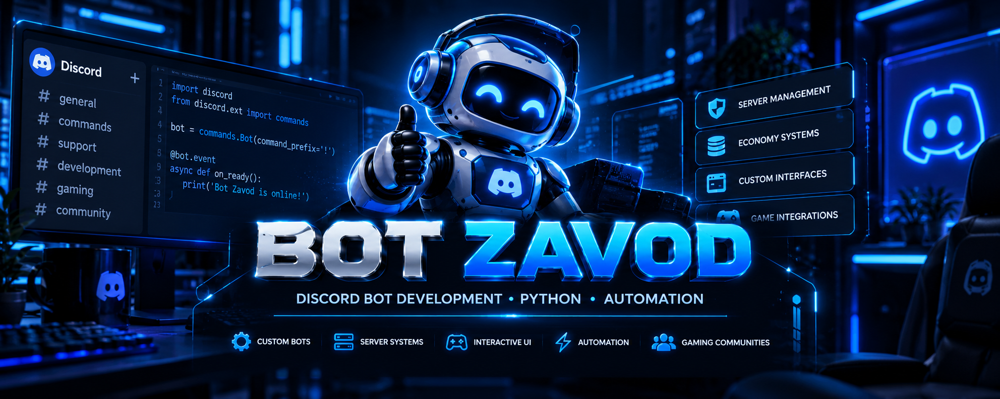

 

<strong>Discord Bot Development • Python • Automation</strong>

Custom Bots · Interactive Systems · Gaming Communities

<a href="#русская-версия">🇷🇺 Русский</a> •
<a href="#english-version">🇬🇧 English</a> •
<a href="https://github.com/BotZavod/gameplay-discord">🎮 GAME PLAY</a> •
<a href="https://github.com/BotZavod/gameplay-discord/blob/main/docs/FEATURES.md">📸 Демонстрация</a> •
<a href="#portfolio">💼 Портфолио</a> •
<a href="https://funpay.com/users/14765417/">📩 Заказать бота</a>

---

## Русская версия

### Разработка Discord-ботов

Разрабатываю Discord-ботов под индивидуальные задачи: от автоматизации отдельных процессов до комплексных систем управления игровыми сообществами.

Основное внимание уделяю удобству пользователей, продуманным интерфейсам, надёжному хранению данных и возможности дальнейшего развития проекта.

| Направление | Возможности |
|:---|:---|
| Индивидуальные боты | Разработка под задачи конкретного сервера |
| Интерактивные интерфейсы | Кнопки, меню, панели управления |
| Экономика | Балансы, награды, магазины, прогресс |
| Управление сервером | Модерация, роли, журналы событий |
| Автоматизация | Тикеты, заявки, уведомления |
| Игровые системы | Профили, кланы, рейтинги |
| Комплексные решения | Объединение функций в единую систему |

**Готовые решения и индивидуальная разработка:**

[Посмотреть предложения на FunPay](https://funpay.com/users/14765417/)

---

## GAME PLAY

**Авторский проект игрового Discord-сообщества.**

GAME PLAY объединяет игроков Dota 2, Counter-Strike 2, Rust и PUBG.

В основе проекта — собственный Discord-бот с интерактивными интерфейсами и единой игровой экосистемой.

### Основные направления

- Профили игроков, уровни и система прогресса
- Внутренняя экономика и игровые награды
- Кланы, рейтинги и игровые активности
- Интерактивные панели управления
- Поддержка участников и администрирование
- Интеграция Steam

Проект развивается и проходит последовательное тестирование.

**[Присоединиться к GAME PLAY](https://discord.gg/JP8GMRbnUZ)**

---

## English Version

### Custom Discord Bot Development

I develop custom Discord bots and integrated systems for gaming communities, server management, and automation.

My focus is on intuitive interfaces, reliable data handling, maintainable architecture, and solutions tailored to each project's requirements.

| Area | Solutions |
|:---|:---|
| Custom bots | Tailored Discord bot development |
| Interactive UI | Buttons, menus, management panels |
| Economy | Balances, rewards, shops, progression |
| Server management | Moderation, roles, event logs |
| Automation | Tickets, applications, notifications |
| Gaming systems | Profiles, clans, leaderboards |
| Integrated solutions | Multiple features in one system |

**Featured project:** GAME PLAY, a gaming community platform with custom Discord systems, player progression, and an internal economy.

[Explore development services](https://funpay.com/users/14765417/)

---

## Technologies

**Python · Discord API · Databases · Interactive UI · Automation**

Development focuses on modular systems, persistent data, user-friendly interfaces, and maintainable project architecture.

---

## Portfolio

### BOT ZAVOD

Custom Discord bots, ready-to-use solutions, and server automation.

**GAME PLAY** serves as a flagship example of designing a connected gaming community ecosystem.

Detailed case studies, demonstrations, and technical articles will be published as projects are prepared for public presentation.

[GitHub Profile](https://github.com/BotZavod)

---

## Contacts

**Have a Discord bot idea or need a custom solution?**

**Есть идея Discord-бота или нужна индивидуальная разработка?**

 

[GitHub](https://github.com/BotZavod) •
[FunPay](https://funpay.com/users/14765417/) •
[Discord](https://discord.gg/5ENDb7e4vj)

 

---

BOT ZAVOD · Discord Development · Gaming Systems · Automation

