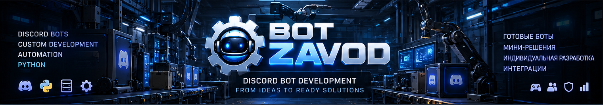

# ⚙️ BOT ZAVOD

**CUSTOM DISCORD BOT DEVELOPMENT · INTERACTIVE UI · AUTOMATION**

*Custom Solutions · Unique Design · Gaming Communities*

### Индивидуальная разработка Discord-ботов под ваши задачи

**От небольших ботов до комплексных Discord-систем с собственным дизайном**

[🇷🇺 Русский](#русская-версия) · [🇬🇧 English](#english-version)

[🛒 FunPay](https://funpay.com/users/14765417/) · [💬 Discord](https://discord.gg/5ENDb7e4vj) · [🎮 GAME PLAY](https://github.com/BotZavod/gameplay-discord)

---

## 🇷🇺 Разработка Discord-ботов на заказ

### Ваши идеи. Наша реализация.

**BOT ZAVOD** занимается индивидуальной разработкой Discord-ботов на Python для игровых сообществ, частных серверов, команд и различных проектов.

Мы создаём как небольшие решения для автоматизации отдельных задач, так и комплексные Discord-системы с собственным дизайном, интерактивными панелями, виртуальной экономикой, игровыми механиками и административными инструментами.

**Каждый бот разрабатывается по техническому заданию заказчика.**

Мы не предлагаем обязательные наборы функций или фиксированные комплектации. Архитектура, интерфейс, возможности, сроки и стоимость определяются индивидуально.

---

## 💎 Два направления разработки

### STANDARD DEVELOPMENT · PREMIUM DEVELOPMENT

| | 🚀 STANDARD DEVELOPMENT | 👑 PREMIUM DEVELOPMENT |
|:---|:---|:---|
| **Назначение** | Небольшие и специализированные боты | Комплексные Discord-системы |
| **Функциональность** | Одна или несколько согласованных задач | Несколько взаимосвязанных подсистем |
| **Интерфейс** | Удобные кнопки, меню и сообщения при необходимости | Единый индивидуальный дизайн и расширенная навигация |
| **Архитектура** | Под конкретную задачу | С учётом взаимодействия модулей и дальнейшего развития |
| **Примеры** | Автороли, заявки, тикеты, модерация, уведомления | Экономика, игровые системы, профили, кланы, административные центры |
| **Стоимость** | Индивидуально по ТЗ | Индивидуально по ТЗ |

**STANDARD** и **PREMIUM** обозначают масштаб и подход к разработке, а не готовые комплекты.

Любая функция из примеров может обсуждаться отдельно. Итоговый состав проекта определяется только после согласования требований.

**[👑 Подробнее об индивидуальной разработке](CUSTOM-DEVELOPMENT.md)**

---

## 🏭 Основные направления работы

| Направление | Подробнее |
|:---|:---|
| 👑 Разработка Discord-ботов по ТЗ | [Индивидуальная разработка](CUSTOM-DEVELOPMENT.md) |
| 🎨 Уникальный дизайн и интерактивные панели | [Возможности](CAPABILITIES.md) |
| 🧩 Модерация, экономика, игры и автоматизация | [Модули](MODULES.md) |
| 💎 Форматы и направления услуг | [Каталог услуг](CATALOG.md) |
| 🎮 Реальные проекты и примеры интерфейсов | [Портфолио](PORTFOLIO.md) |
| 📩 Согласование и оформление заказа | [Как заказать](ORDER.md) |

---

## ✨ Подход BOT ZAVOD

### Не просто команды. Полноценная система управления.

### 🎨 Индивидуальный дизайн

Оформление интерактивных панелей, кнопок, меню и информационных сообщений в едином стиле, согласованном с заказчиком.

### 🧭 Удобная навигация

Продуманные интерфейсы для участников и администрации. Основные действия могут выполняться через кнопки и меню без необходимости запоминать множество команд.

### ⚙️ Функциональность под задачи

Разрабатываются только необходимые возможности. Нет обязательной покупки лишних модулей или заранее определённых комплектов.

### 🛡️ Контроль и надёжность

Проверка прав доступа, обработка ошибок, сохранение данных, журналирование и защита критически важных операций в рамках требований проекта.

### 🧩 Масштабируемая архитектура

При необходимости система проектируется с учётом расширения функциональности, взаимодействия модулей и последующего сопровождения.

### 📦 Передача результата

Исходный код, инструкции, помощь с установкой и дальнейшая поддержка предоставляются в объёме, согласованном до оформления заказа.

---

## 🧩 Что можно разработать?

### От одной функции до комплексной экосистемы

| Категория | Примеры возможностей |
|:---|:---|
| 🛡️ Модерация | Фильтры, предупреждения, логи, Anti-Nuke |
| 🎫 Поддержка | Тикеты, заявки, архив обращений |
| 👥 Участники | Автороли, верификация, управление доступом |
| 💰 Экономика | Виртуальная валюта, магазин, инвентарь |
| 🎮 Игры | Мини-игры, уровни, рейтинги, кланы |
| 🎉 Мероприятия | Розыгрыши, турниры, расписания |
| 📊 Статистика | Активность, отчёты, информационные панели |
| 🎵 Голосовые системы | Музыка, радио, автоматические голосовые комнаты |
| 🧭 Интерфейсы | Интерактивные панели и административные центры |
| 🔗 Интеграции | Telegram, внешние API, уведомления, автоматизация |
| 💼 Управление доступом | Подписки, временные роли, закрытые разделы |
| 🧠 Нестандартные решения | Уникальные системы по техническому заданию |

**Это примеры направлений индивидуальной разработки, а не список готовых товаров.**

Техническая возможность реализации отдельных функций и интеграций уточняется при обсуждении проекта.

[🧩 Все модули](MODULES.md) · [⚙️ Полный список возможностей](CAPABILITIES.md)

---

## 🎮 GAME PLAY

### Флагманский проект BOT ZAVOD

**DOTA 2 · CS2 · RUST · PUBG**

*Gaming Community · Interactive Systems · Custom Development*

**GAME PLAY** представляет подход BOT ZAVOD к созданию комплексных Discord-систем с единым визуальным оформлением и интерактивным управлением.

Проект разрабатывается для собственного игрового сообщества и объединяет несколько функциональных направлений:

- 🎨 Единый фирменный дизайн интерфейсов.
- 🧭 Интерактивные панели и навигацию.
- 👤 Профили участников.
- 💰 Виртуальную экономику.
- 🎲 Мини-игры.
- 🏰 Кланы и игровые сообщества.
- 🔗 Steam-верификацию.
- 🎫 Систему поддержки.
- 🎵 Музыкальные и голосовые функции.
- ⚙️ Административные инструменты.

**Особое внимание уделяется удобству участников и администрации, согласованному дизайну и взаимодействию функций.**

Часть возможностей уже реализована, другие продолжают разрабатываться, интегрироваться или проходить тестирование. Описание проекта не означает, что все перечисленные системы уже запущены в рабочем сообществе.

**[🎮 Открыть GAME PLAY](https://github.com/BotZavod/gameplay-discord)**

[📸 Все интерфейсы](PORTFOLIO.md) · [💬 Discord-сервер](https://discord.gg/5ENDb7e4vj)

> GAME PLAY является авторским проектом и демонстрацией подхода к разработке. Он не предлагается как готовый бот для покупки.

---

## 🛠️ Технологии и архитектура

| Технология | Применение |
|:---|:---|
| **Python** | Основная логика Discord-ботов |
| **Discord API** | Взаимодействие с Discord |
| **Interactive UI** | Кнопки, меню, формы и панели |
| **Databases** | Хранение настроек, профилей и данных |
| **External APIs** | Интеграции при технической возможности |
| **Automation** | Фоновые процессы, расписания и уведомления |

Выбор библиотек, базы данных, структуры проекта и способа размещения зависит от требований и масштаба разработки.

---

## 📩 Как заказать Discord-бота?

### Пять шагов от идеи до результата

**01. Задача**

Опишите идею, желаемые функции или отправьте техническое задание.

**02. Обсуждение**

Определим возможности, дизайн, интерфейсы, особенности работы и технические ограничения.

**03. Согласование**

До оплаты согласуем состав работ, стоимость, сроки и условия передачи проекта.

**04. Разработка**

После оформления заказа выполняются программирование, настройка и тестирование в рамках согласованного задания.

**05. Передача**

Вы получаете результат, исходные материалы и инструкции в соответствии с условиями заказа.

**[🛒 Обсудить проект на FunPay](https://funpay.com/users/14765417/)**

[📋 Подробный порядок заказа](ORDER.md) · [👑 Индивидуальная разработка](CUSTOM-DEVELOPMENT.md)

---

## 🇬🇧 Custom Discord Bot Development

### Your Ideas. Custom Implementation.

**BOT ZAVOD** develops custom Python Discord bots for gaming communities, private servers, teams, and other projects.

We build everything from focused automation tools to advanced Discord systems featuring unique visual design, interactive interfaces, virtual economies, gaming mechanics, and administrative tools.

**Every bot is developed according to the client's specific requirements.**

We do not sell mandatory feature bundles or fixed configurations. Architecture, functionality, interface design, timeline, and pricing are agreed upon individually.

---

## 💎 Two Development Approaches

### STANDARD DEVELOPMENT · PREMIUM DEVELOPMENT

| | 🚀 STANDARD DEVELOPMENT | 👑 PREMIUM DEVELOPMENT |
|:---|:---|:---|
| **Purpose** | Focused bots and automation tools | Advanced Discord systems |
| **Functionality** | One or several agreed tasks | Multiple connected subsystems |
| **Interface** | Practical buttons, menus, and messages where needed | Unified custom design and advanced navigation |
| **Architecture** | Designed for a specific task | Designed for integration and future expansion |
| **Examples** | Autoroles, applications, tickets, moderation, notifications | Economies, gaming systems, profiles, clans, admin centers |
| **Pricing** | Individually quoted | Individually quoted |

**STANDARD** and **PREMIUM** describe the scope and approach of development, not prebuilt packages.

The final feature set is determined through project requirements and mutual agreement.

**[👑 Learn More About Custom Development](CUSTOM-DEVELOPMENT.md)**

---

## 🏭 Explore Our Services

| Service | Details |
|:---|:---|
| 👑 Custom Discord Bot Development | [Custom Development](CUSTOM-DEVELOPMENT.md) |
| 🎨 Unique Design & Interactive Panels | [Capabilities](CAPABILITIES.md) |
| 🧩 Moderation, Economy, Games & Automation | [Modules](MODULES.md) |
| 💎 Custom Development Options | [Service Catalog](CATALOG.md) |
| 🎮 Real Projects & Interface Examples | [Portfolio](PORTFOLIO.md) |
| 📩 Ordering & Project Agreement | [How to Order](ORDER.md) |

---

## ✨ The BOT ZAVOD Approach

### More Than Commands. A Complete User Experience.

### 🎨 Custom Visual Design

Interactive panels, buttons, menus, and information messages designed around a consistent visual identity.

### 🧭 Intuitive Navigation

Convenient interfaces for members and administrators. Common actions can be handled through buttons and menus rather than requiring numerous commands.

### ⚙️ Tailored Functionality

Only the functionality your project needs. No mandatory modules or predefined bundles.

### 🛡️ Reliability & Control

Permission checks, error handling, persistent data, logging, and safeguards for important operations according to the agreed requirements.

### 🧩 Expandable Architecture

Where appropriate, systems are designed to support additional modules, connected functionality, and future improvements.

### 📦 Project Delivery

Source code, documentation, setup assistance, and ongoing support are provided according to the agreed project scope.

---

## 🧩 What Can We Build?

### From a Single Feature to a Complete Discord Ecosystem

| Category | Example Features |
|:---|:---|
| 🛡️ Moderation | Filters, warnings, logs, Anti-Nuke |
| 🎫 Support | Tickets, applications, request archives |
| 👥 Members | Autoroles, verification, access management |
| 💰 Economy | Virtual currencies, shops, inventories |
| 🎮 Gaming | Mini-games, levels, rankings, clans |
| 🎉 Events | Giveaways, tournaments, schedules |
| 📊 Statistics | Activity tracking, reports, dashboards |
| 🎵 Voice Systems | Music, radio, automatic voice channels |
| 🧭 Interfaces | Interactive panels and admin centers |
| 🔗 Integrations | Telegram, external APIs, notifications |
| 💼 Access Management | Subscriptions, temporary roles, private sections |
| 🧠 Specialized Solutions | Unique systems developed to specification |

**These are examples of potential custom development, not ready-made products.**

Technical feasibility is evaluated individually, particularly for external integrations.

[🧩 Explore Modules](MODULES.md) · [⚙️ All Capabilities](CAPABILITIES.md)

---

## 🎮 Featured Project: GAME PLAY

### BOT ZAVOD Flagship Project

**DOTA 2 · CS2 · RUST · PUBG**

*Gaming Community · Interactive Systems · Custom Development*

**GAME PLAY** demonstrates BOT ZAVOD's approach to creating advanced Discord systems with consistent visual design and interactive management.

The project covers several connected development areas:

- 🎨 Unified interface styling.
- 🧭 Interactive navigation panels.
- 👤 Member profiles.
- 💰 Virtual economy.
- 🎲 Mini-games.
- 🏰 Clans and gaming communities.
- 🔗 Steam verification.
- 🎫 Support systems.
- 🎵 Music and voice features.
- ⚙️ Administration tools.

**The central focus is usability, consistent design, and connected functionality.**

Some features are implemented, while others remain under development, integration, or testing. This showcase does not imply that every feature is currently deployed in production.

**[🎮 Explore GAME PLAY](https://github.com/BotZavod/gameplay-discord)**

[📸 Interface Showcase](PORTFOLIO.md) · [💬 Discord Community](https://discord.gg/5ENDb7e4vj)

> GAME PLAY is an original development project and portfolio showcase. It is not offered as a prebuilt bot for sale.

---

## 🛠️ Technologies & Architecture

| Technology | Application |
|:---|:---|
| **Python** | Core Discord bot functionality |
| **Discord API** | Discord integration |
| **Interactive UI** | Buttons, menus, forms, and dashboards |
| **Databases** | Persistent settings, profiles, and records |
| **External APIs** | Integrations where technically feasible |
| **Automation** | Background tasks, schedules, and notifications |

The final technology stack, database, project structure, and hosting approach depend on the requirements and scope.

---

## 📩 How to Order a Discord Bot

### Five Steps From Idea to Delivery

**01. Requirements**

Describe your idea, desired functionality, or provide a technical specification.

**02. Discussion**

We review features, design, interfaces, technical requirements, and limitations.

**03. Agreement**

Before payment, we agree on project scope, pricing, timeline, and delivery terms.

**04. Development**

After the order is confirmed, development, configuration, and testing begin according to the agreed specification.

**05. Delivery**

You receive the completed project, source materials, and instructions as specified in the agreement.

**[🛒 Discuss Your Project on FunPay](https://funpay.com/users/14765417/)**

[📋 Ordering Guide](ORDER.md) · [👑 Custom Development](CUSTOM-DEVELOPMENT.md)

---

### ⚙️ Explore BOT ZAVOD

[🏠 Home](README.md) · [🧩 Modules](MODULES.md) · [💎 Services](CATALOG.md) · [👑 Custom Development](CUSTOM-DEVELOPMENT.md) · [🎮 Portfolio](PORTFOLIO.md) · [📩 Order](ORDER.md)

**BOT ZAVOD · Custom Discord Development · Interactive Systems · Gaming Communities**

